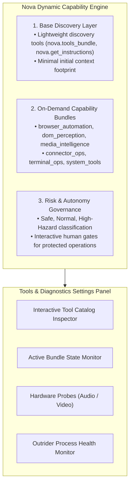

# Tools, Capability Bundles & System Diagnostics

> [!NOTE]
> Open **Menu → Settings → Tools** (or press `Alt+F` / `Alt+E` and select **Settings → Tools**) to explore Nova's MCP tool catalog, inspect active capability bundles, review tool risk categories, configure application settings, and execute hardware diagnostic probes.

---

## 1. Overview & Capability Engine

Nova AI Workspace exposes over 500 specialized tools spanning web navigation, DOM perception, multimedia capture, system terminals, database connectors, and network administration. Exposing every tool schema simultaneously to an AI agent would waste tens of thousands of tokens per request, degrading reasoning performance and inflating context costs.

To solve this, Nova utilizes a dynamic **Modular Capability Engine**:



---

## 2. Interactive Tool Catalog Inspector

Under **Settings → Tools → Tool Catalog**, operators and developers can browse Nova's entire tool registry:

* **Real-Time Search & Filtering:** Filter tools by keyword, category, or capability bundle (e.g. `browser_automation`, `connector_ops`, `task_memory`).
* **JSON Schema Inspector:** Click any tool to view its formal JSON Schema parameters, required vs. optional fields, allowed enum values, and default behaviors.
* **Security Risk Classification:**
  * **Safe:** Read-only inspection tools with zero persistent side effects (e.g. [`nova.app_settings_get`](../../mcp-reference/tools/app-shell-and-ui/nova-app-settings-get.md), `nova.read_text`).
  * **Normal:** Standard interactive commands (e.g. `nova.click_selector`, `nova.type_selector`).
  * **High-Hazard:** Operations with substantial consequences (e.g. `nova.cache_clear`, financial transactions, public network scanning), requiring explicit human confirmation.

---

## 3. Dynamic Capability Bundling ([`nova.tools_bundle`](../../mcp-reference/tools/app-shell-and-ui/nova-tools-bundle.md))

Connected agents start with a lean base catalog. When an agent determines that a task requires specialized functionality, it dynamically activates the appropriate capability bundle:

```json
{
  "name": "nova.tools_bundle",
  "arguments": {
    "bundle": "browser_automation"
  }
}
```

### Supported Bundles Include:
* **`browser_automation`:** Page navigation, tab lifecycle, clicking, typing, and settlement waiting.
* **`dom_perception`:** Structured DOM extraction, visual element measurement, and selector resolution.
* **`media_intelligence`:** Audio transcription, OCR text recognition, image transformation, and media playback audits.
* **`connector_ops`:** SSH command execution, SFTP transfers, and remote database queries.
* **`terminal_ops`:** Windows pseudo-console (ConPTY) terminal dock management.
* **`task_memory`:** Domain Notes, Operator Notes, and project onboarding guidelines.

In the Tools settings panel, you can monitor which capability bundles are currently active for each connected agent session.

---

## 4. Hardware Diagnostics & Peripheral Probes

Before executing complex audio recording, speech synthesis, or computer vision automation, operators and agents can test connected hardware peripherals without relying on external web services:

### 4.1 Audio Loopback Diagnostic Probe
Verify microphone input levels and speaker audio playback pipelines:
* **Start Audio Probe ([`nova.hardware_diagnostics_start`](../../mcp-reference/tools/media-and-transcription/nova-hardware-diagnostics-start.md)):**
  ```json
  {
    "kind": "audio"
  }
  ```
* **Inspect Probe State ([`nova.hardware_diagnostics_state`](../../mcp-reference/tools/media-and-transcription/nova-hardware-diagnostics-state.md)):** Measures input decibel levels, clipping warnings, and sample rates.
* **Stop Audio Probe ([`nova.hardware_diagnostics_stop`](../../mcp-reference/tools/media-and-transcription/nova-hardware-diagnostics-stop.md)):** Shuts down the diagnostic stream and releases audio endpoints.

### 4.2 Video Camera Diagnostic Probe
Test connected webcams, supported resolutions, and frame grabbers:
* **Start Video Probe ([`nova.hardware_diagnostics_start`](../../mcp-reference/tools/media-and-transcription/nova-hardware-diagnostics-start.md)):**
  ```json
  {
    "kind": "video"
  }
  ```
  *(Note: The kind parameter strictly accepts `"video"`, not `"camera"`).*
* **Device Characteristics ([`nova.device_diagnostics`](../../mcp-reference/tools/device-emulation/nova-device-diagnostics.md)):** Inspects camera driver details, supported resolutions (e.g. 1080p, 4K), and DirectX video acceleration.

---

## 5. Application Settings Governance

Nova exposes a curated set of runtime preferences to connected agents while strictly guarding sensitive configuration toggles:

* **Querying Settings ([`nova.app_settings_get`](../../mcp-reference/tools/app-shell-and-ui/nova-app-settings-get.md)):**
  ```json
  {
    "keys": ["emulationViewportFrameEnabled", "developerOptionsEnabled"]
  }
  ```
* **Updating Permitted Settings ([`nova.app_settings_set`](../../mcp-reference/tools/app-shell-and-ui/nova-app-settings-set.md)):**
  ```json
  {
    "values": {
      "emulationViewportFrameEnabled": true
    }
  }
  ```
* **Protected Key Enforcement:** Sensitive switches (such as `developerOptionsEnabled` or agent autonomy overrides) are read-only for agents. Any attempt to modify them returns `reasonCode: "app_settings.protected"`.

---

## 6. The Outrider Helper Process (`NovaBrowser.Outrider.exe`)

Certain operating system operations—such as low-level hardware probing, deep file metadata extraction, and killable network probes—carry stability risks. 

Nova delegates these tasks to an isolated child process, **Outrider**:
* **Crash Resilience:** If a faulty camera driver or corrupt media file crashes the probe, only the Outrider process terminates. Nova's main browser window, open tabs, and live MCP connections remain completely unaffected.
* **Process Auto-Recovery:** Nova detects Outrider process termination instantly and relaunches a fresh helper instance upon the next probe request.

---

## 7. Summary Tool Matrix

| Tool | Capability | Primary Use Case |
| :--- | :--- | :--- |
| [`nova.tools_bundle`](../../mcp-reference/tools/app-shell-and-ui/nova-tools-bundle.md) | Load capability bundle | Dynamically activate specialized toolsets on demand. |
| [`nova.hardware_diagnostics_start`](../../mcp-reference/tools/media-and-transcription/nova-hardware-diagnostics-start.md) | Start hardware probe | Test microphone input (`kind="audio"`) or webcam frames (`kind="video"`). |
| [`nova.hardware_diagnostics_state`](../../mcp-reference/tools/media-and-transcription/nova-hardware-diagnostics-state.md) | Inspect probe state | Read real-time audio volume levels and camera frame telemetry. |
| [`nova.hardware_diagnostics_stop`](../../mcp-reference/tools/media-and-transcription/nova-hardware-diagnostics-stop.md) | Stop hardware probe | Terminate diagnostic stream and release media hardware. |
| [`nova.device_diagnostics`](../../mcp-reference/tools/device-emulation/nova-device-diagnostics.md) | Query device features | Inspect GPU acceleration, touch input, and screen orientation. |
| [`nova.app_settings_get`](../../mcp-reference/tools/app-shell-and-ui/nova-app-settings-get.md) | Read app settings | Inspect current application configuration keys. |
| [`nova.app_settings_set`](../../mcp-reference/tools/app-shell-and-ui/nova-app-settings-set.md) | Update app settings | Apply curated runtime preferences (e.g. emulation framing). |

---

## 8. Related Documentation

* **[Settings Hub](README.md)** — Main overview of all 14 settings panels.
* **[Developer Options Settings](developer-options.md)** — DevTools launch behavior and CDP commands.
* **[Agent Governance & MCP](agent-governance-and-mcp.md)** — Programmatic settings access and curated keys.
* **[Media & OCR Tools Guide](../tools/media-and-ocr.md)** — Media capture, transcription, and optical character recognition.

---

[Back to Settings Hub](README.md) · [All user guides](../README.md)
