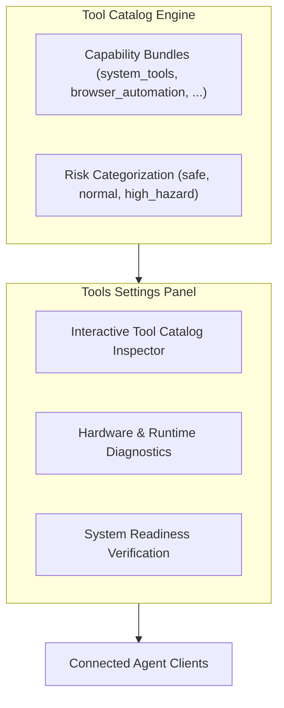

# Tools & Capabilities Settings

> [!NOTE]
> Open **Menu → Settings → Tools** (or press `Alt+F` / `Alt+E` and select **Settings → Tools**) to explore Nova's MCP tool catalog, inspect active capability bundles, review tool risk categories, and execute hardware diagnostic probes.

---

## 1. Overview

Nova AI Workspace provides hundreds of specialized tools across web navigation, DOM perception, media intelligence, system terminals, and network administration. To maintain agent efficiency and prevent token bloat, Nova organizes these capabilities into modular **Capability Bundles**.

The **Tools & diagnostics** settings panel gives you full visibility into Nova's tool ecosystem, providing an interactive catalog browser and system diagnostics suite for testing your local environment.

---

## 2. Interactive Tool Catalog Inspector

Under **Settings → Tools → Tool Catalog**, you can browse every tool exposed by Nova's MCP server:

* **Search & Filter:** Search tools by name, description keyword, or capability bundle (e.g. `system_tools`, `app_shell_recovery`, `dom_perception`).
* **Parameter Schema Viewer:** Click any tool entry to inspect its JSON Schema definitions, required vs optional parameters, allowed enum values, and default fallbacks.
* **Risk Classification:** Every tool displays its assigned security risk level:
  * **Safe:** Read-only operations with no persistent side-effects (e.g. `nova.app_settings_get`, `nova.read_text`).
  * **Normal:** Standard interactive operations (e.g. `nova.click_selector`, `nova.app_settings_set`).
  * **High-Hazard:** Operations with persistent or high-impact consequences (e.g. `nova.cache_clear`, financial form submissions).

---

## 3. Capability Bundles Management

Rather than loading hundreds of tool schemas simultaneously into an agent's context window, Nova uses on-demand dynamic bundling:

* **Base Tools:** Every connected agent starts with lightweight discovery tools (`nova.tools_bundle`, `nova.get_instructions`).
* **Dynamic Bundle Activation:** When an agent needs specialized features, it calls `nova.tools_bundle(bundle='...')` to load the appropriate capability suite.
* **Settings Inspection:** The Tools settings panel lists all available bundles and shows which bundles are currently loaded by active agent sessions.

---

## 4. Hardware & Runtime Diagnostics Probes

Nova includes an integrated diagnostics suite for verifying hardware peripherals and operating system features before starting complex automated tasks:

* **Audio Input/Output Loopback Test:** Verifies microphone input levels and speaker playback without relying on external web testing services.
* **Video Capture Probe:** Tests connected webcam hardware, supported frame resolutions, and encoding formats.
* **GPU & WebView2 Render Check:** Verifies Direct3D hardware acceleration status and logs GPU driver incidents.
* **Outrider Helper Status:** Confirms that `NovaBrowser.Outrider.exe` (Nova's external process for killable OS probes) is responsive and functioning properly.

---

## 5. Related Documentation

* **[Settings Hub](README.md)** — Main overview of all 14 settings panels.
* **[Connectors Settings](connectors.md)** — External MCP servers and service connectors.
* **[Developer Options Settings](developer-options.md)** — DevTools launch behaviors and minidumps.
* **[Agent Governance & MCP](agent-governance-and-mcp.md)** — Programmatic settings access and curated keys.
