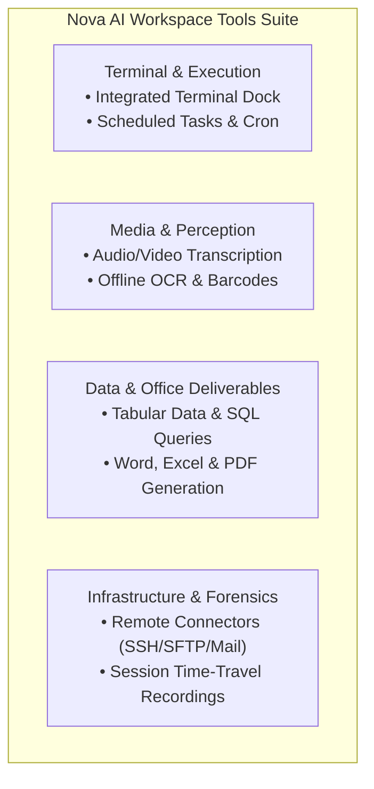

# Workspace Tools

> [!NOTE]
> Nova AI Workspace integrates development, automation, document, and forensic tools directly into the browser shell, providing both human operators and AI agents with unified local capabilities beyond standard tab browsing.

---

## 1. Overview

Rather than requiring a patchwork of external utilities, desktop command-line apps, and third-party cloud services, Nova provides a self-contained suite of built-in workspace tools. All tools execute locally on your Windows machine, respecting your configured privacy policies and sandbox boundaries.

---

## 2. Available Tools Directory

| Tool | Focus Area | Key Capabilities |
| :--- | :--- | :--- |
| **[Integrated Terminal Dock](terminal.md)** | ConPTY Shell & PowerShell | Embedded slide-up terminal dock (`Ctrl+~`), multi-session management, AI agent terminal access, workspace isolation. |
| **[Audio & Video Transcription](transcription.md)** | Offline Whisper Speech-to-Text | 100% local speech-to-text via `whisper.cpp`, multi-language support, local model downloads, text and `.srt`/`.vtt` subtitle export. |
| **[Media Intelligence, Local OCR & Barcodes](media-and-ocr.md)** | Offline OCR, Barcodes & Image Processing | Local OCR on images and scanned PDFs (Tesseract + PaddleOCR), number verification, 1D/2D barcode scanning and generation, contact sheets. |
| **[Tabular Data Analysis & Document Workflows](data-and-documents.md)** | SQL Queries & Document Creation | Web table extraction (`nova.extract_table`), local SQL queries on CSV/JSON/SQLite (`nova.data_query`), Markdown conversion, Word (`.docx`), Excel (`.xlsx`), and PDF generation. |
| **[Scheduled Tasks & Automation](scheduled-tasks.md)** | Background Jobs & Cron Scheduling | Recurring background jobs, Claude Code & Codex CLI execution, PowerShell scripts, DPAPI encrypted secrets, run history. |
| **[Remote Connectors & File Synchronization](connectors.md)** | SSH, SFTP, FTP & Mail Pipelines | Remote Linux SSH command execution and interactive shells, SFTP/FTP file sync, automated IMAP/SMTP email verification, and external MCP tool aggregation. |
| **[Session Recordings](recordings.md)** | Forensics & Time-Travel Debugging | Tamper-resistant, encrypted event streams (network, console, interactions, DOM snapshots) for post-mortem inspection. |

---

## 3. Related Documentation

* **[User Guide Overview](../README.md)** — Daily browsing, sandboxes, settings, and agent collaboration.
* **[Connectors Settings Guide](../settings/connectors.md)** — Managing server endpoints and authentication credentials.
* **[Core Features Hub](../../core-features/README.md)** — Architectural documentation for all Nova subsystems.
* **[MCP Reference](../../mcp-reference/README.md)** — Model Context Protocol tool catalog and schema definitions.
