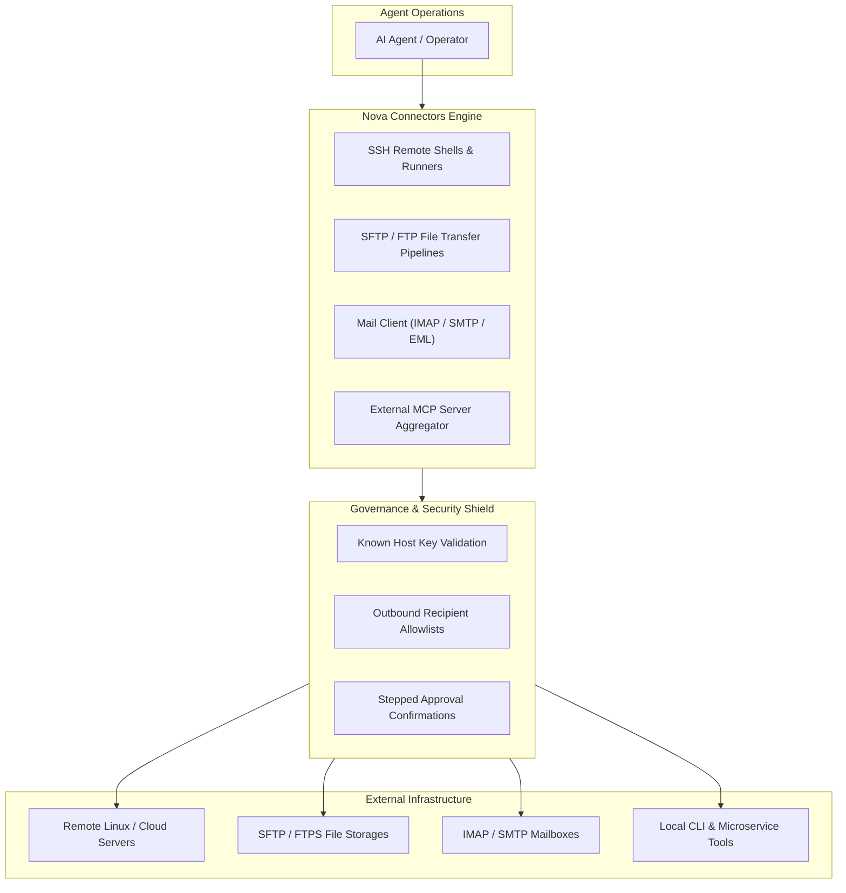

# Remote Connectors & File Synchronization

> [!NOTE]
> Nova AI Workspace includes built-in connectors for remote servers (SSH, SFTP, FTP/FTPS), automated email management (IMAP/SMTP), and external MCP server aggregation, allowing AI agents to orchestrate end-to-end infrastructure workflows directly from the browser.

---

## 1. Overview

Autonomous web agents frequently interact with external systems beyond the browser DOM: deploying web applications after testing, uploading generated reports to remote file servers, verifying user registration emails, or calling specialized local microservices.

Rather than forcing you to configure external SSH clients, mail daemons, or separate background proxies, Nova provides **Integrated Connectors**. Each connector operates under Nova's unified security model, allowing you to define strict server allowlists, manage connection credentials in your local vault, and enforce stepped human confirmations before sensitive remote actions occur.

---

## 2. Remote Shell Execution (SSH)

Nova allows agents and operators to interact securely with remote servers without spawning external terminal windows:

* **One-Shot Command Execution (`nova.ssh_run`):** Executes a single command or a batch of commands on a remote Linux/Unix host and returns exit codes, stdout, and stderr. Features aggregate flood protection via `maxTotalOutputBytes` (curling loud streams in the middle while keeping quiet streams intact), ANSI escape stripping, and automated credential masking.
* **Interactive Shell Sessions (`nova.ssh_shell_open`):** Spawns a persistent, bidirectional SSH pseudo-terminal (PTY). Agents can send keystrokes with `nova.ssh_shell_send`, read reconstructed screen state with `nova.ssh_shell_read`, and resize the virtual window with `nova.ssh_shell_resize`.
* **Prompt Synchronization & Slicing:** In interactive shells, `nova.ssh_shell_send(waitFor='prompt')` waits for the shell prompt (or a regex pattern) and returns command text immediately in `output.text`. Alternatively, `nova.ssh_shell_read(output='since_last_send')` retrieves output emitted since the last send without manual screen scraping.
* **Cryptographic Authentication:** Supports OpenSSH private key files (RSA, ECDSA, Ed25519) and password authentication. Host keys are cryptographically verified against known-host records to defend against man-in-the-middle attacks.

---

## 3. Secure File Transfers (SFTP & FTP/FTPS)

For transferring web assets, log archives, or test deliverables between your local machine and remote servers:

* **Remote Directory Navigation:** List remote directories, query file sizes and permissions, and create nested folders using `nova.sftp_list` and `nova.sftp_mkdir`.
* **Uploading & Downloading:** Transfer files safely using `nova.sftp_put` and `nova.sftp_get`. Both operations support resuming interrupted transfers (`resumeUnfinished=true`) and verifying SHA-256 checksums (`verifySha256=true`) upon completion.
* **Connection Notes:** Connector profiles support operator notes (`note`, up to 500 characters) visible in `nova.connector_list`, documenting hosting details, server roles, and infrastructure contexts.
* **Asynchronous Transfer Management:** Large multi-gigabyte transfers run in the background. Agents monitor active transfer progress with `nova.sftp_transfer_status` and can halt running jobs cleanly using `nova.sftp_transfer_stop`.
* **Legacy Protocol Support:** When interacting with legacy enterprise mainframes or hosting providers, Nova provides matching `nova.ftp_*` tools supporting explicit FTPS encryption.

---

## 4. Remote Database Queries over SSH (MySQL & MariaDB)

Nova provides dedicated, credential-isolated database querying directly through an active SSH connection via `nova.db_query`:

* **No Shell Access Required:** Runs queries without granting interactive shell execution (`process.exec`). Queries are executed by the remote database client via an isolated SSH exec channel.
* **Zero Credential Exposure:** Database passwords are transmitted to the remote client exclusively via standard input (`--defaults-file=/dev/stdin`). Passwords never appear in process lists, command arguments, or agent transcripts.
* **Pre-Execution Inspection:** Strictly validates each query before sending. Blocks multi-statement execution, SQL comments, schema mutations (`DROP`, `ALTER`, `CREATE`), administrative commands (`GRANT`, `KILL`), and file operations (`LOAD_FILE`, `INTO OUTFILE`).
* **Server-Enforced Read Safety:** Read queries (`mode='read'`) run within a `START TRANSACTION READ ONLY` envelope with statement timeouts (`timeoutMs`). Data modifications require explicit `mode='write'` and the `db.write` capability grant.
* **Privilege Audit:** Queries run `SHOW GRANTS` on the connection to report effective user privileges (`readOnlyUser: true`, `riskyGrants`), ensuring least-privilege configurations.
* **Profile Configuration:** Databases are linked to SFTP connections via `nova.connector_database_set` (or Nova Settings) and removed via `nova.connector_database_delete`.
* **Backups and SQL exports:** `nova.db_export` dumps a database with the same stored login into a private folder on the server (`.sql` or `.sql.gz`), publishes the file only once the dump is verified complete, and keeps running if the connection drops. The file imports into the database selected in phpMyAdmin; by default it carries no `DEFINER` clauses, so the import also works on shared hosting. Download it with `nova.sftp_get(verifySha256=true)`. Exporting needs its own permission, `db.export`.

---

## 5. Automated Email Management (IMAP / SMTP)

Automating user signups, invoice notifications, and password resets requires reliable email interaction:

* **Inbox Monitoring & Token Extraction:** Query incoming emails with `nova.mail_list` and read message bodies with `nova.mail_read`. Agents can automatically extract 6-digit verification codes, magic login links, or invoice attachments during automated onboarding testing.
* **Local EML Archiving:** Export individual messages or entire mail folders into standard `.eml` archive files (`nova.mail_export_eml`, `nova.mail_backup_start`) for compliance records or offline inspection.
* **Transactional Outbound Delivery (`nova.mail_send`):** Send automated email reports via SMTP. To prevent accidental data exfiltration or spam, Nova enforces outbound recipient allowlists configured in **Settings → Connectors**.

---

## 6. External MCP Server Aggregation

Nova can act as an MCP hub, bridging external tools directly into the browser's agent interface:

* **Server Registration:** Register local CLI-based MCP servers (e.g., database inspectors, Kubernetes controllers, or git extensions) under **Settings → Connectors → External MCP Servers**.
* **Dynamic Tool Discovery:** Nova inspects the external server's capabilities and exposes them through `nova.external_tools` and `nova.external_tool_call`.
* **Selective Tool Release:** You can toggle individual external tools on or off, ensuring that only trusted operations are presented to your AI agents.

---

## 7. Security Governance & Approval Gates

All connector capabilities operate under Nova's enterprise permission model:

* **Settings Authorization:** Connectors remain disabled until explicitly configured and enabled by a human user in **Menu → Settings → Connectors**.
* **Stepped Confirmation:** Destructive operations—such as executing remote root commands, deleting remote directories, or sending external emails—can be configured to require stepped user approval in the UI before execution.

---

## 7. Related Documentation

* **[Tools Overview](README.md)** — Master hub for all built-in workspace tools.
* **[Connectors Settings Guide](../settings/connectors.md)** — Configuring server endpoints and credentials.
* **[Integrated Terminal Dock](terminal.md)** — Local ConPTY terminal dock.
* **[Scheduled Tasks & Automation](scheduled-tasks.md)** — Running recurring automated jobs.
