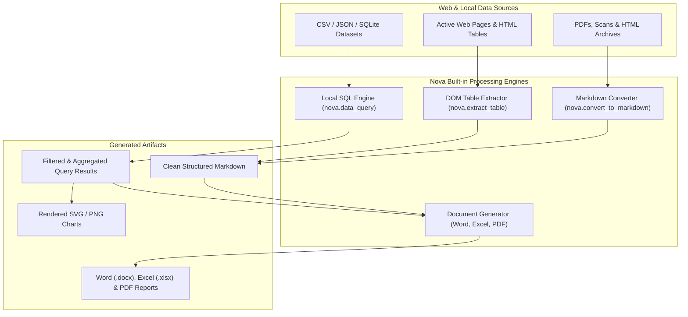

# Tabular Data Analysis & Document Workflows

> [!NOTE]
> Nova AI Workspace includes native tools for extracting web tables, querying local datasets with SQL, converting documents to Markdown, and generating Microsoft Word, Excel, and PDF files directly from agent workflows.

---

## 1. Overview

Research, automated data gathering, and enterprise reporting frequently require transforming unstructured web content into structured tabular formats, analyzing local spreadsheets, or assembling clean PDF and Word deliverables for human stakeholders.

Rather than forcing AI agents to invent brittle custom scripts or rely on external Python runtimes, Nova integrates a robust document and data engine. All file generation, data inspection, and SQL querying execute locally on your machine with zero cloud exfiltration.



---

## 2. Web Table Extraction (`nova.extract_table`)

When scraping financial metrics, inventory lists, or comparison matrices from the web:

* **Semantic Table Parsing:** Identifies standard HTML `<table>` elements as well as modern `role="grid"` and `role="table"` ARIA structures.
* **Header & Span Recognition:** Automatically resolves `rowspan` and `colspan` attributes, ensuring that merged cells do not misalign columns in the extracted data.
* **Structured Output Formats:** Returns tabular data as structured JSON objects, raw CSV strings, or clean Markdown tables suitable for immediate insertion into agent analysis reports.
* **Targeting Tables:** Agents can target specific tables by CSS selector, table index on the page, or by searching for distinctive column header titles.

---

## 3. Local SQL Data Queries (`nova.data_inspect` & `nova.data_query`)

AI agents frequently struggle when asked to analyze large datasets (such as a 50 MB CSV file containing 100,000 transaction rows), as loading the full text into the model's context window causes severe token bloat or context truncation.

Nova solves this with an in-engine local SQL query pipeline:

### Schema Inspection (`nova.data_inspect`)
Before querying an unfamiliar file, the agent inspects the dataset schema without reading the full file into memory:
* **Metrics Returned:** Total row count, column names, automatically detected data types (`INTEGER`, `REAL`, `TEXT`, `DATETIME`), sample row values, and null-value frequencies.
* **Supported Formats:** CSV, TSV, JSON, JSONL, and SQLite database files.

### In-Memory SQL Execution (`nova.data_query`)
Once the schema is known, the agent executes standard SQL queries directly against the file:
* **Aggregations & Filtering:** Run `SELECT`, `WHERE`, `GROUP BY`, `HAVING`, and mathematical aggregations (`COUNT`, `SUM`, `AVG`, `MIN`, `MAX`).
* **Context Preservation:** Only the precise, aggregated query result (e.g. top 5 spending categories) is returned to the agent's context window, allowing agents to process massive datasets in milliseconds while using minimal tokens.

---

## 4. Document Conversion to Markdown (`nova.convert_to_markdown`)

Nova converts local digital documents, presentations, spreadsheets, and web files into clean, structured Markdown for agent analysis without external Python scripts or cloud services:

* **Supported Document Formats:** PDF, Microsoft Word (`.docx`), Excel (`.xlsx`), PowerPoint (`.pptx`), HTML, EPUB e-books, CSV/TSV, JSON, and plain text.
* **Content Signature Recognition:** Files are identified by binary magic bytes rather than misleading file extensions, ensuring renamed downloads or mislabeled exports are converted correctly.
* **Flexible Output Modes:**
  * `outputMode: "inline"` (default): Returns Markdown directly in the tool response, bounded by `maxChars` (default 30,000 characters).
  * `outputMode: "file"`: Writes the full, unclipped Markdown document to disk (up to 2,000,000 characters).
  * `outputMode: "both"`: Returns an inline preview while writing the complete document to disk.

### Example: Converting a Word Contract with File Output
```json
{
  "name": "nova.convert_to_markdown",
  "arguments": {
    "path": "C:\\Users\\me\\Downloads\\VendorContract.docx",
    "outputMode": "both",
    "outputPath": "C:\\Reports\\VendorContract.md",
    "maxChars": 20000
  }
}
```

---

## 5. Professional Document Generation

Nova empowers agents to author publication-ready deliverables directly on the local machine with zero dependencies on Microsoft Office:

### Generating Microsoft Word Documents (`nova.docx_create`)

`nova.docx_create` compiles standard GitHub Flavored Markdown into native Word (`.docx`) packages:
* **Structural Elements:** Headings (`#` through `######`) map directly to native Word heading styles, ensuring Microsoft Word's navigation pane and table of contents function seamlessly.
* **Tables & Headers:** Markdown pipe tables are rendered at 100% column width with repeating bold header rows (`tblHeader`) on every subsequent page and aligned columns.
* **Local Image Embedding:** Embeds local PNG, JPEG, GIF, and BMP graphics directly into the document, scaling them proportionally to fit page margins without distortion.
* **Safety & Integrity:** Uses a two-phase commit: the document is written to a temporary `.nova-part` file and verified via Nova's internal parser before being atomically finalized. Existing files are never overwritten (`output_exists`).

#### Example: Generating an Executive Summary with Embedded Chart
```json
{
  "name": "nova.docx_create",
  "arguments": {
    "title": "Quarterly Operations Review",
    "pageSize": "A4",
    "markdown": "# Executive Summary\n\nOperational throughput improved by **14.2%** during Q3 across all monitored clusters.\n\n## Performance Breakdown\n\n| Cluster | Target | Achieved | Status |\n| :--- | :---: | ---: | :---: |\n| Alpha | 1,000 | 1,120 | Normal |\n| Beta | 800 | 935 | Normal |\n\n> All metrics were gathered via local telemetry probes.\n\n",
    "outputPath": "C:\\Reports\\Q3_Operations_Review.docx"
  }
}
```

### Generating Microsoft Excel Workbooks (`nova.xlsx_create`)

`nova.xlsx_create` streams structured data into native OpenXML SpreadsheetML workbooks (`.xlsx`) with automated styling, column width heuristics, and formula evaluation:

* **Formula Safety Invariant:** To prevent spreadsheet formula injection attacks, raw text strings beginning with `=` are stored as inline text strings (`<c t="inlineStr">`) and displayed verbatim. Formulas are authored exclusively via explicit `{ "formula": "..." }` cell descriptors and calculated automatically on open (`fullCalcOnLoad`).
* **Auto-Formatting (`autoFormat: true`):** Automatically adds a frozen header row (`ySplit="1"`), bold header typography, thin bottom borders, auto-filter dropdowns, and calculates proportional column widths based on cell content.
* **Typed Formatting:** Format columns as `general`, `text`, `integer`, `decimal`, `currency` (custom `currencySymbol`), `percent`, `date`, or `datetime`.
* **In-Tab Verification (`openInTab` & `fitToData`):** Immediately opens the newly created workbook in Nova's read-only tabular viewer with auto-zoom for immediate inspection or recording.

#### Example: Multi-Sheet Financial Report with Formulas and Live Tab Preview
```json
{
  "name": "nova.xlsx_create",
  "arguments": {
    "autoFormat": true,
    "currencySymbol": "€",
    "openInTab": true,
    "fitToData": true,
    "sheets": [
      {
        "name": "Revenue Summary",
        "columns": [
          "Region",
          { "name": "Q1 Revenue", "format": "currency" },
          { "name": "Q2 Revenue", "format": "currency" },
          { "name": "Total", "format": "currency" }
        ],
        "rows": [
          ["North America", 450000.00, 520000.00, { "formula": "SUM(B2:C2)" }],
          ["Europe", 380000.00, 410000.00, { "formula": "SUM(B3:C3)" }],
          ["Asia-Pacific", 290000.00, 340000.00, { "formula": "SUM(B4:C4)" }]
        ]
      }
    ]
  }
}
```

### End-to-End Workflow: From Web Scrape to Styled Deliverable

AI agents can chain Nova's data and document tools into seamless pipelines:
1. Extract tabular data from an intranet portal with `nova.extract_table`.
2. Clean, filter, and aggregate numbers with SQL using `nova.data_query`.
3. Synthesize a professional Excel workbook with auto-filters using `nova.xlsx_create`.
4. Render key trend charts with `nova.chart_create`.
5. Compile an executive Word report embedding the chart and table summary using `nova.docx_create`.

---

## 6. Local Archive Management

When dealing with downloaded archives or log bundles:

* **Archive Inspection (`nova.archive_inspect`):** Lists directory trees, file sizes, and compression ratios inside `.zip`, `.tar`, `.tar.gz`, and `.7z` archives without extracting them to disk.
* **Safe Extraction (`nova.archive_extract`):** Safely unpacks archives into a designated target directory. Includes built-in directory-traversal guards that reject malicious zip-slip payloads attempting to write files outside the target folder.

---

## 7. Related Documentation

* **[Tools Overview](README.md)** — Master hub for all built-in workspace tools.
* **[Documents, Word & Excel Troubleshooting](../../troubleshooting/documents-and-office.md)** — Diagnosing formula errors, locked files, and conversion issues.
* **[Media Intelligence, Local OCR & Barcodes](media-and-ocr.md)** — Optical character recognition and barcode decoding.
* **[Integrated Terminal Dock](terminal.md)** — Running local command-line environments.
* **[Media Intelligence Core Architecture](../../core-features/media-intelligence/README.md)** — Deep technical specification of document and media engines.
