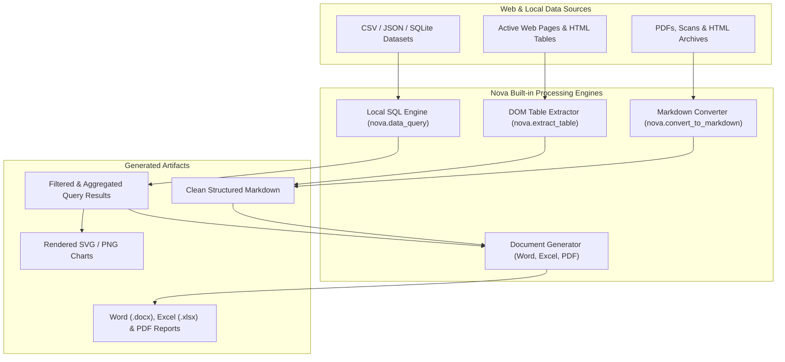

# Tabular Data Analysis & Document Workflows

> [!NOTE]
> Nova AI Workspace includes native tools for extracting web tables, querying local datasets with SQL, converting documents to Markdown, and generating Microsoft Word, Excel, and PDF files directly from agent workflows.

---

## 1. Overview

Research, automated data gathering, and enterprise reporting frequently require transforming unstructured web content into structured tabular formats, analyzing local spreadsheets, or assembling clean PDF and Word deliverables for human stakeholders.

Rather than forcing AI agents to invent brittle custom scripts or rely on external Python runtimes, Nova integrates a robust document and data engine. All file generation, data inspection, and SQL querying execute locally on your machine with zero cloud exfiltration.

---

## 2. Web Table Extraction (`nova.extract_table`)

When scraping financial metrics, inventory lists, or comparison matrices from the web:

* **Semantic Table Parsing:** Identifies standard HTML `<table>` elements as well as modern `role="grid"` and `role="table"` ARIA structures.
* **Header & Span Recognition:** Automatically resolves `rowspan` and `colspan` attributes, ensuring that merged cells do not misalign columns in the extracted data.
* **Structured Output Formats:** Returns tabular data as structured JSON objects, raw CSV strings, or clean Markdown tables suitable for immediate insertion into agent analysis reports.
* **Targeting Tables:** Agents can target specific tables by CSS selector, table index on the page, or by searching for distinctive column header titles.

---

## 3. Local SQL Data Queries (`nova.data_inspect` & `nova.data_query`)

AI agents frequently struggle when asked to analyze large datasets (such as a 50 MB CSV file containing 100,000 transaction rows), as loading the full text into the model's context window causes severe token bloat or context truncation.

Nova solves this with an in-engine local SQL query pipeline:

### Schema Inspection (`nova.data_inspect`)
Before querying an unfamiliar file, the agent inspects the dataset schema without reading the full file into memory:
* **Metrics Returned:** Total row count, column names, automatically detected data types (`INTEGER`, `REAL`, `TEXT`, `DATETIME`), sample row values, and null-value frequencies.
* **Supported Formats:** CSV, TSV, JSON, JSONL, and SQLite database files.

### In-Memory SQL Execution (`nova.data_query`)
Once the schema is known, the agent executes standard SQL queries directly against the file:
* **Aggregations & Filtering:** Run `SELECT`, `WHERE`, `GROUP BY`, `HAVING`, and mathematical aggregations (`COUNT`, `SUM`, `AVG`, `MIN`, `MAX`).
* **Context Preservation:** Only the precise, aggregated query result (e.g. top 5 spending categories) is returned to the agent's context window, allowing agents to process massive datasets in milliseconds while using minimal tokens.

---

## 4. Document Conversion to Markdown

Nova provides clean document conversion utilities designed to preserve document semantics while removing distracting web chrome:

* **Web to Markdown (`nova.convert_to_markdown`):** Strips navigation menus, cookie banners, tracking scripts, and sidebars, extracting the primary article text formatted in standard GitHub Flavored Markdown.
* **PDF Reading (`nova.read_pdf`):** Extracts textual layers from local PDF files. For scanned or hybrid PDFs containing image-only pages, it automatically invokes Nova's offline OCR engine to reconstruct text layers transparently.

---

## 5. Professional Document Generation

Agents can author formatted, production-ready deliverables directly on your Windows desktop:

| Document Type | Tool | Capabilities |
| :--- | :--- | :--- |
| **Microsoft Word** | `nova.docx_create` | Creates structured `.docx` files with heading hierarchies, bullet lists, callout boxes, styled tables, and embedded images. |
| **Microsoft Excel** | `nova.xlsx_create` | Creates multi-sheet `.xlsx` workbooks with custom column widths, number formatting (currency, percentages), header styling, and calculated spreadsheet formulas. |
| **PDF Composition** | `nova.pdf_compose` | Assembles multi-page PDF documents from images, HTML templates, or Markdown documents. |
| **PDF Splitting** | `nova.pdf_split` | Extracts specific page ranges or splits multi-page PDF scans into individual documents. |
| **Data Charts** | `nova.chart_create` | Generates publication-ready bar, line, pie, and scatter charts rendered as high-resolution PNG or vector SVG graphics. |

---

## 6. Local Archive Management

When dealing with downloaded archives or log bundles:

* **Archive Inspection (`nova.archive_inspect`):** Lists directory trees, file sizes, and compression ratios inside `.zip`, `.tar`, `.tar.gz`, and `.7z` archives without extracting them to disk.
* **Safe Extraction (`nova.archive_extract`):** Safely unpacks archives into a designated target directory. Includes built-in directory-traversal guards that reject malicious zip-slip payloads attempting to write files outside the target folder.

---

## 7. Related Documentation

* **[Tools Overview](README.md)** — Master hub for all built-in workspace tools.
* **[Media Intelligence, Local OCR & Barcodes](media-and-ocr.md)** — Optical character recognition and barcode decoding.
* **[Integrated Terminal Dock](terminal.md)** — Running local command-line environments.
* **[Media Intelligence Core Architecture](../../core-features/media-intelligence/README.md)** — Deep technical specification of document and media engines.
