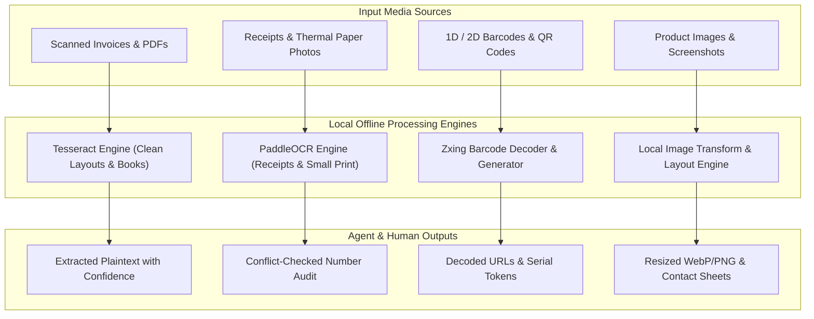
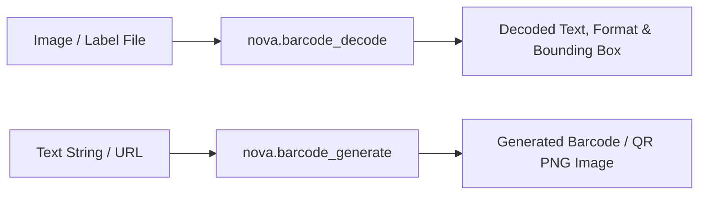

# Media Intelligence, Local OCR & Barcodes

> [!NOTE]
> Nova AI Workspace includes 100% local, offline media processing tools. You and your AI agents can perform optical character recognition (OCR) on images and scanned PDFs, scan and generate barcodes, and transform images directly on your machine without third-party cloud uploads.

---

## 1. Overview

Web automation often encounters media that cannot be inspected using standard HTML DOM queries: scanned paper documents, receipts, screenshots containing error messages, embedded charts, and QR codes.

Nova bridges this gap by integrating native offline media intelligence engines directly into the workspace. All recognition, processing, and generation routines execute locally on your Windows CPU or GPU, guaranteeing that sensitive business receipts, invoices, and credentials never leave your device.

---

## 2. Offline Optical Character Recognition (OCR)

The OCR subsystem (`nova.ocr_read`) extracts text from image files (PNG, JPEG, TIFF, BMP, WebP) and image-only PDF pages where no selectable text layer exists.

### Dual Recognition Engines
Nova ships with two complementary offline OCR engines, each optimized for specific document types:

| Recognition Engine | Best Suited For | Structural Strengths |
| :--- | :--- | :--- |
| **Tesseract** | Clean printed documents: contracts, formal letters, legal notices, book pages. | Preserves paragraph structures, indentation, and clean typography. Fast execution. |
| **PaddleOCR** | Receipts, thermal paper, dense order forms, skewed scans, and photos of physical paper. | Keeps items and prices aligned on single lines; excels at low-contrast or noisy text. |

### Automatic Arbitration & Number Verification
When running in default automatic mode (`engine: "auto"`):
1. **Initial Scan:** Every page is read with Tesseract first for maximum speed.
2. **Confidence Verification:** If Tesseract confidence is low or if numerical digits are detected, the page is re-scanned using PaddleOCR.
3. **Number Conflict Detection:** If the two engines read conflicting numbers (e.g. `$1,420.00` vs `$1,428.00`), Nova marks the page as `uncertain` and reports both candidate values in `numberConflicts`. Because a single misread digit can alter financial records, Nova surfaces the discrepancy rather than guessing.
4. **Side-by-Side Comparison:** Calling with `engine: "both"` returns full readings from both engines side-by-side, enabling agents to verify critical contract clauses or invoice amounts.

### Asynchronous Job Lifecycle
Because deep OCR recognition takes several seconds per page, long-running scans execute as asynchronous background jobs:
* **Immediate Return:** Calls wait up to a configurable duration (default 45 seconds). If recognition completes within that window, results are returned immediately.
* **Background Polling:** If processing multiple pages, Nova returns `status: "running"` with a unique `jobId`. Agents poll job progress using `nova.ocr_status(jobId='...')`.
* **Safe Interruption:** A long-running job can be halted at any time via `nova.ocr_stop(jobId='...')`, preserving all pages recognized up to the point of cancellation.

---

## 3. Barcodes & QR Codes

Automated workflows frequently require reading tracking numbers from shipping labels, parsing two-factor authentication QR codes, or generating barcode labels for warehouse systems.

### Decoding Barcodes (`nova.barcode_decode`)
* **Supported Formats:** QR Code, Data Matrix, Aztec, UPC-A, UPC-E, EAN-8, EAN-13, Code 39, Code 93, Code 128, Codabar, and PDF417.
* **Detection Details:** Returns the decoded string, barcode format, error correction level, and bounding box coordinates within the source image.
* **Multi-Code Scanning:** Detects and decodes multiple distinct barcodes located on a single shipping label or document page simultaneously.

### Generating Barcodes (`nova.barcode_generate`)
* **Programmatic Creation:** Generate high-resolution PNG barcodes by specifying the desired format, content text, width, height, and quiet-zone margins.
* **Use Cases:** Generating return shipping labels, creating event ticket QR codes, or preparing inventory tags for automated filing.

---

## 4. Local Image Processing & Contact Sheets

Nova provides native image manipulation tools, allowing agents to prepare web assets, resize screenshots, and inspect visual evidence without requiring external graphics packages:

* **Image Inspection (`nova.image_info`):** Queries image dimensions, pixel aspect ratios, file size, color depth, and EXIF orientation metadata.
* **Format Transformation (`nova.image_transform`):** Resizes, crops, rotates, and converts images between PNG, JPEG, and WebP formats. Supports preserving aspect ratios and applying quality compression.
* **Contact Sheet Generation (`nova.image_contact_sheet`):** Combines multiple screenshots or document pages into a single grid overview image (contact sheet), allowing human operators to inspect twenty verification steps in a single glance.

---

## 5. Hardware Diagnostics Probes

Before starting sensitive media tasks (such as joining web meetings, recording audio notes, or verifying video streams), Nova includes interactive hardware probes:

* **Audio Loopback Verification:** Measures live microphone input levels and plays a brief test chime to verify speaker output.
* **Webcam Capture Probe:** Tests connected webcam devices, confirms supported video resolutions and frame rates, and ensures that camera privacy shutters are open.
* **Diagnostic Tools:** Controlled via `nova.hardware_diagnostics_start(kind='video')` (or `kind='audio'`), providing real-time device health metrics.

---

## 6. Related Documentation

* **[Tools Overview](README.md)** — Master hub for all built-in workspace tools.
* **[Audio & Video Transcription](transcription.md)** — Offline speech-to-text with whisper.cpp.
* **[Tabular Data & Document Workflows](data-and-documents.md)** — Table extraction, SQL queries, and document generation.
* **[Media Intelligence Core Architecture](../../core-features/media-intelligence/README.md)** — In-depth architectural details of Nova's media engine.
