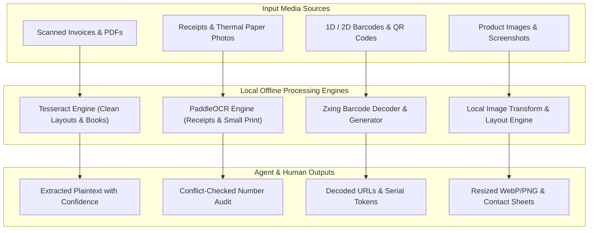

# Media Intelligence, Local OCR & Barcodes

> [!NOTE]
> Nova AI Workspace includes 100% local, offline media processing tools. You and your AI agents can perform optical character recognition (OCR) on images and scanned PDFs, scan and generate barcodes, and transform images directly on your machine without third-party cloud uploads.

---

## 1. Overview

Web automation often encounters media that cannot be inspected using standard HTML DOM queries: scanned paper documents, receipts, screenshots containing error messages, embedded charts, and QR codes.

Nova bridges this gap by integrating native offline media intelligence engines directly into the workspace. All recognition, processing, and generation routines execute locally on your Windows CPU or GPU, guaranteeing that sensitive business receipts, invoices, and credentials never leave your device.



---

## 2. Offline Optical Character Recognition (OCR)

The OCR subsystem (`nova.ocr_read`) extracts text from image files (PNG, JPEG, TIFF, BMP, WebP) and image-only PDF pages where no selectable text layer exists.

### Dual Recognition Engines
Nova ships with two complementary offline OCR engines, each optimized for specific document types:

| Recognition Engine | Best Suited For | Structural Strengths |
| :--- | :--- | :--- |
| **Tesseract** | Clean printed documents: contracts, formal letters, legal notices, book pages. | Preserves paragraph structures, indentation, and clean typography. Fast execution. |
| **PaddleOCR** | Receipts, thermal paper, dense order forms, skewed scans, and photos of physical paper. | Keeps items and prices aligned on single lines; excels at low-contrast or noisy text. |

### Automatic Arbitration & Number Verification
When running in default automatic mode (`engine: "auto"`):
1. **Initial Scan:** Every page is read with Tesseract first for maximum speed.
2. **Confidence Verification:** If Tesseract confidence is low or if numerical digits are detected, the page is re-scanned using PaddleOCR.
3. **Number Conflict Detection:** If the two engines read conflicting numbers (e.g. `$1,420.00` vs `$1,428.00`), Nova marks the page as `uncertain` and reports both candidate values in `numberConflicts`. Because a single misread digit can alter financial records, Nova surfaces the discrepancy rather than guessing.
4. **Side-by-Side Comparison:** Calling with `engine: "both"` returns full readings from both engines side-by-side, enabling agents to verify critical contract clauses or invoice amounts.

### Asynchronous Job Lifecycle
Because deep OCR recognition takes several seconds per page, long-running scans execute as asynchronous background jobs:
* **Immediate Return:** Calls wait up to a configurable duration (default 45 seconds). If recognition completes within that window, results are returned immediately.
* **Background Polling:** If processing multiple pages, Nova returns `status: "running"` with a unique `jobId`. Agents poll job progress using `nova.ocr_status(jobId='...')`.
* **Safe Interruption:** A long-running job can be halted at any time via `nova.ocr_stop(jobId='...')`, preserving all pages recognized up to the point of cancellation.

---

## 3. Barcodes & QR Codes

Automated workflows frequently require reading tracking numbers from parcel shipping labels, parsing printed invoices, verifying retail product codes, or generating styled QR badges with integrated Wi-Fi credentials or SEPA payment instructions.

```mermaid
flowchart TD
    subgraph DecodePipeline ["Decoding Pipeline (nova.barcode_decode)"]
        ScanFile["Local Image File<br>(PNG, JPEG, TIFF, WebP, BMP)"] --> GrayPre["Grayscale Conversion & Inversion<br>(Gray8, AutoRotate, TryInverted)"]
        GrayPre --> MultiEngine["12-Symbology Engine<br>(QR, Data Matrix, Aztec, PDF417, EAN/UPC, 1D)"]
        MultiEngine --> SafeOut["Passive Data Output<br>(contentTrust: untrusted_document)"]
    end

    subgraph GenPipeline ["Generation Pipeline (nova.barcode_generate)"]
        InputSpec["Payload & Parameters<br>(content or structured data object)"] --> StructBuilder["Structured Payload Builder<br>(Wi-Fi, vCard, MeCard, GiroCode, Event)"]
        StructBuilder --> GS1Check["Modulo-10 Check Digit Gate<br>(Strict Refusal of Bad Digits)"]
        GS1Check --> MatrixDraw["SkiaSharp Whole-Pixel Matrix<br>(styles: classic, rounded, dots)"]
        MatrixDraw --> ContrastGate["WCAG Contrast Check (>= 4.5:1)<br>& Camera Stress Simulation (8 checks)"]
        ContrastGate --> ReadBackAssert["Read-Back Assertion<br>(Decode-Before-Write Verification)"]
        ReadBackAssert --> DiskCommit["Atomic Commit to Disk<br>(Never Overwrites Existing Files)"]
    end
```



---

### 3.1 Decoding Barcodes from Images (`nova.barcode_decode`)

The `nova.barcode_decode` tool scans local image files (photos, screenshots, scanned PDF pages) to extract 1D barcodes and 2D matrix symbologies:

* **12 Supported Symbologies:** QR Code, Data Matrix, Aztec, PDF417, EAN-13, EAN-8, UPC-A, UPC-E, Code 128, Code 39, Code 93, ITF (Interleaved 2 of 5), and Codabar.
* **Multi-Code Scanning:** Setting `multiple: true` scans the entire image and returns every distinct code found along with its pixel bounding coordinates (`position`).
* **Format Filtering:** Restrict scanning to specific symbologies via `formats: ["qr", "ean13"]` to accelerate processing and eliminate false reads.
* **Heuristic Inversion & Rotation:** The decoder automatically rotates skewed images (`AutoRotate`), tests inverted reflectance for white-on-dark labels (`TryInverted`), and performs heuristic edge recovery (`TryHarder`).
* **Untrusted Document Security Invariant:** Decoded strings are returned strictly as passive data (`contentTrust: "untrusted_document"`). Nova **never automatically navigates to or opens decoded URLs**, shielding agents and operators from malicious physical QR stickers and Indirect Prompt Injections.

#### Example: Decoding a Shipping Label
```json
{
  "name": "nova.barcode_decode",
  "arguments": {
    "path": "C:\\Users\\Operator\\Downloads\\shipping-label.png",
    "multiple": true
  }
}
```

---

### 3.2 Generating Barcodes & QR Codes (`nova.barcode_generate`)

Nova synthesizes crisp, verified raster (`format: "png"`) and scalable vector (`format: "svg"`) codes directly on your workstation without cloud dependencies or Python libraries.

#### Supported Generation Types:
1. **QR Code (`type: "qr"`):** Supports 1 to 2,000 characters of full Unicode (UTF-8, umlauts, kanji, emoji), error correction levels `L` (7%), `M` (15%), `Q` (25%), and `H` (30%), custom styling, gradients, and logo plates.
2. **Code 128 (`type: "code128"`):** High-density alphanumeric barcode supporting 1 to 80 printable ASCII characters (codes 32 to 126).
3. **Retail GS1 Codes (`type: "ean13"`, `"ean8"`, `"upca"`):** Retail barcodes with mandatory GS1 Modulo-10 check digits.

> [!IMPORTANT]
> **GS1 Modulo-10 Check Digit Integrity:**
> Nova refuses to quietly "fix" invalid check digits. If you provide a complete barcode with an incorrect check digit, Nova halts with `invalid_check_digit` and names the correct digit. If you omit the check digit (supplying 7, 11, or 12 digits), Nova automatically computes and appends it.

---

### 3.3 High-Level Structured Data Payloads (`data.kind`)

Instead of manually constructing complex raw strings where syntax errors cause mobile apps to fail, pass a structured `data` object to `nova.barcode_generate`:

#### 1. Instant Guest Wi-Fi Access (`wifi`)
Generates standardized `WIFI:` payloads. The network password is automatically masked in the response object (`encodedContentHidden`) to prevent credential leakage in chat histories:
```json
{
  "name": "nova.barcode_generate",
  "arguments": {
    "type": "qr",
    "data": {
      "kind": "wifi",
      "ssid": "Company-Guest",
      "password": "SecurePassword2026",
      "security": "wpa"
    },
    "caption": "Guest Wi-Fi Access"
  }
}
```

#### 2. SEPA Bank Transfer / GiroCode (`epc`)
Generates official EPC069-12 v002 payment QR codes readable by European banking applications. Nova strictly validates the IBAN using the ISO 13616 Modulo-97 algorithm:
```json
{
  "name": "nova.barcode_generate",
  "arguments": {
    "type": "qr",
    "data": {
      "kind": "epc",
      "name": "Acme Industrial Supplies GmbH",
      "iban": "DE89370400440532013000",
      "bic": "DBEUT33GXXX",
      "amount": "149.50",
      "text": "Invoice INV-2026-4412"
    }
  }
}
```

#### 3. Compact Electronic Business Cards (`mecard` vs `vcard`)
While `vcard` (vCard 3.0) supports complete corporate metadata, `mecard` produces the same contact information using roughly half the characters. This results in significantly larger module blocks that scan reliably from compact printed business cards:
```json
{
  "name": "nova.barcode_generate",
  "arguments": {
    "type": "qr",
    "data": {
      "kind": "mecard",
      "name": "Elena Rostova",
      "organization": "Nova Cognitive Systems",
      "phone": "+491701234567",
      "email": "elena.rostova@example.com",
      "url": "https://nova-cognitive.com"
    },
    "style": "rounded"
  }
}
```

#### 4. Calendar Appointments & URI Schemes
* **Calendar Event (`event`):** RFC 5545 `VEVENT` with all-day dates (`2026-10-20`), floating local times (`2026-10-20T09:30`), or fixed UTC instants (`2026-10-20T09:30Z`).
* **Direct URIs:** `email` (`mailto:`), `tel` (dialable phone numbers), `sms` (`sms:`), and `geo` (`geo:` decimal latitude and longitude).

---

### 3.4 Aesthetic Styling, Contrast & Verification Invariants

1. **Module Geometry & Preserved Structure:**
   * Style choices: `classic` (sharp square blocks), `rounded` (smooth corners), or `dots` (circular dots).
   * **Invariable Structural Marks:** Regardless of style, finder patterns ($7\times 7$), timing rows, and alignment squares are **always drawn as solid squares** to guarantee instantaneous camera detection.
2. **WCAG Contrast Governance:**
   * Modules must be darker than the background (`inverted_colors` guard).
   * Nova enforces a minimum contrast ratio of **`4.5:1`** across all foreground shades, background tones, finder colors, and every sampled point along multi-color gradients (`gradientTo` with `gradientDirection: "diagonal" | "horizontal" | "vertical" | "radial"`).
3. **Branded Logo Embedding (`logoPath`):**
   * Automatically promotes Error Correction to **Level `H`** (30% recovery capacity).
   * Center logo plate width is clamped to $\le 28\%$ of total symbol width.
   * Collisions with Version 7+ central alignment patterns are guarded against (`logo_no_room`).
4. **Physical Print Sizing (`printWidthMm`):**
   * Enforces a minimum module size of **`0.25 mm`** (`print_module_too_small`), ensuring codes printed on paper or packaging can be resolved by mobile camera sensors.
5. **Simulated Camera Stress Suite:**
   * Every code is evaluated across 8 simulated camera stress checks (scaling down to 3 px/module, 65% lossy JPEG compression, Gaussian blur, 15° rotation, 10% 3D tilt, shadow falloff). Results are classified as `robust` (8/8 passed), `verified` (6/8 or 7/8 passed), or `experimental`.
6. **Read-Back Assertion Before Write:**
   * The rendered bitmap is decoded in memory before any bytes are saved to disk. If reading fails, generation aborts with `scan_validation_failed`, preventing corrupted or unreadable assets from reaching production.
7. **No-Overwrite Protection:**
   * Output files default to `Exports/Codes/`. If an explicit `outputPath` points to an existing file, Nova refuses to overwrite it (`barcode_generate.output_exists`).

---

## 4. Local Image Processing & Contact Sheets

Nova provides native image manipulation tools, allowing agents to prepare web assets, resize screenshots, and inspect visual evidence without requiring external graphics packages:

* **Image Inspection (`nova.image_info`):** Queries image dimensions, pixel aspect ratios, file size, color depth, and EXIF orientation metadata.
* **Format Transformation (`nova.image_transform`):** Resizes, crops, rotates, and converts images between PNG, JPEG, and WebP formats. Supports preserving aspect ratios and applying quality compression.
* **Contact Sheet Generation (`nova.image_contact_sheet`):** Combines multiple screenshots or document pages into a single grid overview image (contact sheet), allowing human operators to inspect twenty verification steps in a single glance.

---

## 5. Hardware Diagnostics Probes

Before starting sensitive media tasks (such as joining web meetings, recording audio notes, or verifying video streams), Nova includes interactive hardware probes:

* **Audio & Microphone Verification:** Measures live microphone input levels with real-time VU meter bars and peak clipping indicators in the native `HardwareTestDialog`, and plays a brief 440 Hz test tone to verify speaker output.
* **Webcam Capture Probe:** Tests connected webcam devices, confirms supported video resolutions and frame rates, and ensures that camera privacy shutters are open.
* **Programmatic Diagnostics:** Managed via `nova.hardware_diagnostics_start(kind='video')` (or `kind='microphone'`, `kind='speaker'`). Note that automated camera and microphone diagnostics require a user gesture and fail with `diagnostics.user_gesture_required` when driven over CDP, while speaker verification succeeds.

---

## 6. Related Documentation

* **[Tools Overview](README.md)** — Master hub for all built-in workspace tools.
* **[Hardware Routing & Real-Time Diagnostics](../../core-features/media-intelligence/devices-and-permissions/hardware-routing-and-diagnostics/README.md)** — Architectural specification of ConPTY, WebRTC diagnostics, and AudioGraph VU meters.
* **[Microphone, Camera & Permissions Troubleshooting](../../troubleshooting/media-and-permissions.md)** — Resolving `diagnostics.user_gesture_required`, device locks, and OS privacy blocks.
* **[Audio & Video Transcription](transcription.md)** — Offline speech-to-text with whisper.cpp.
* **[Tabular Data & Document Workflows](data-and-documents.md)** — Table extraction, SQL queries, and document generation.
* **[Media Intelligence Core Architecture](../../core-features/media-intelligence/README.md)** — In-depth architectural details of Nova's media engine.
