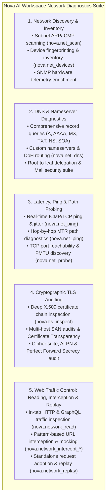
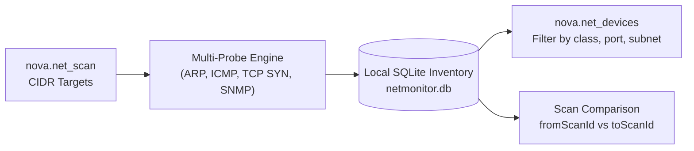
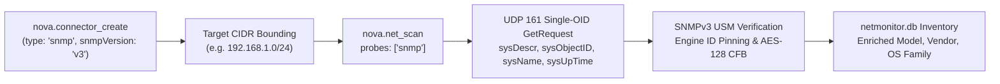
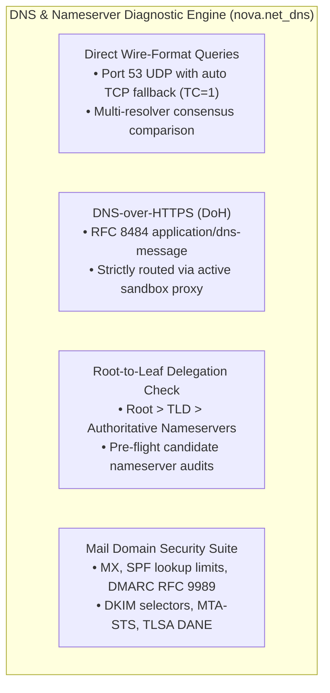
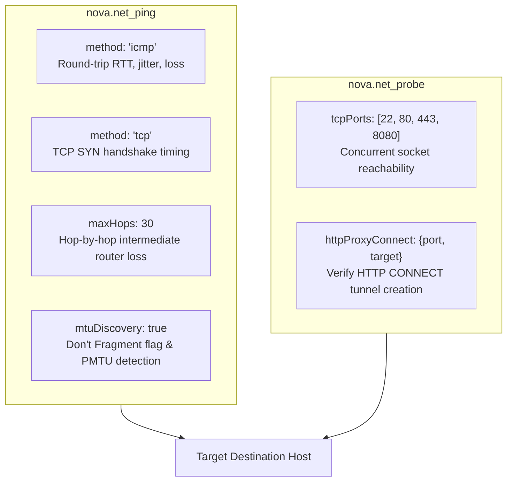
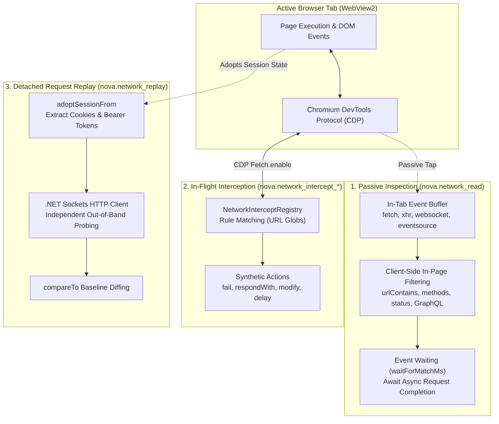
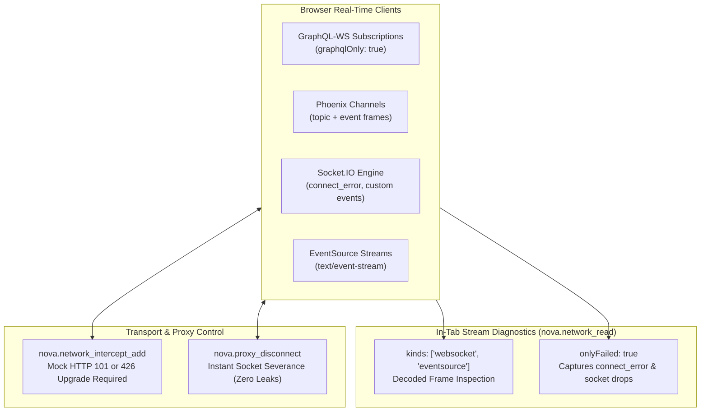
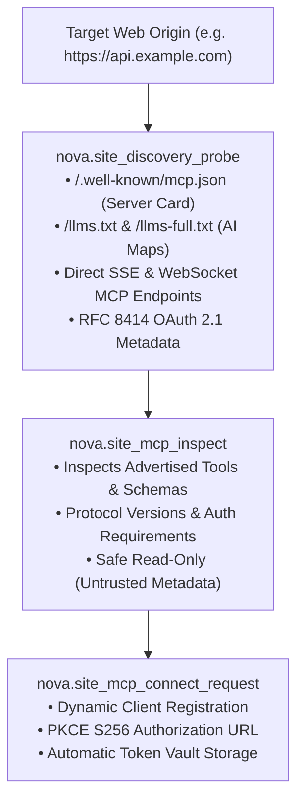
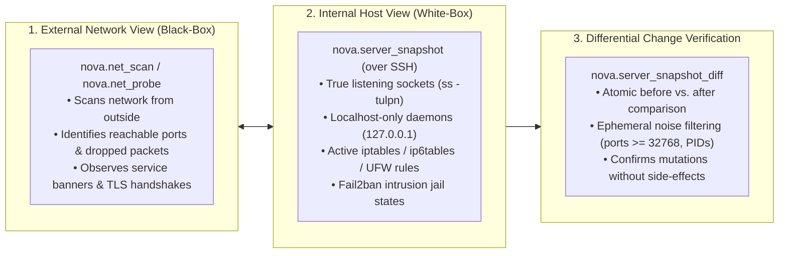

# Network Diagnostics, Probing & Proxy Management

> [!NOTE]
> Nova AI Workspace integrates a comprehensive, enterprise-grade network engineering and diagnostic suite directly into the browser shell. Designed for software developers, system administrators, and autonomous agents, it unifies subnet discovery, recursive DNS diagnostics, path probing, TLS certificate audits, in-flight HTTP interception, and multi-proxy routing without requiring external CLI utilities.

---

## 1. Overview & The Five Diagnostic Disciplines

Troubleshooting modern distributed applications often requires juggling multiple external terminal utilities (`ping`, `traceroute`, `dig`, `nmap`, `curl`, `mitmproxy`). This introduces friction, credential risks, and context fragmentation for both human operators and AI agents.

Nova eliminates this complexity by providing an in-engine **Network Engineering & Diagnostics Suite** organized into five complementary disciplines:



---

## 2. Subnet Scanning & Device Inventory

Nova allows operators and agents to discover active network devices and maintain a persistent, searchable local infrastructure catalog:



### 2.1 Subnet Scanning ([`nova.net_scan`](../../mcp-reference/tools/proxy-and-network/nova-net-scan.md))

Scans IPv4 CIDR blocks (e.g., `192.168.1.0/24`) using non-disruptive ICMP echoes, TCP SYN probes, and ARP discovery:

```json
{
  "name": "nova.net_scan",
  "arguments": {
    "targets": ["192.168.1.0/24"],
    "portSets": ["web", "admin"],
    "discovery": ["arp", "icmp", "mdns", "ssdp"],
    "timeBudgetSeconds": 60
  }
}
```

* **Target CIDR Ranges (`targets`):** Provide single host IPs, bounded IP ranges (`10.0.0.10-80`), or CIDR subnets (`192.168.1.0/24`, up to `/20`).
* **Port Profiles (`portSets`):** Select pre-configured port groupings:
  * `"quick"`: 20 common ports (default).
  * `"admin"`: Remote management and directories (SSH 22, RDP 3389, Telnet 23, WinRM 5985, LDAP 389/636/3268/3269).
  * `"web"`: Web ports 80, 443, 8080, 8443.
  * `"database"`: Database engines (MySQL 3306, PostgreSQL 5432, Redis 6379, MongoDB 27017, MSSQL 1433).
  * `"mail"`: Mail services (SMTP 25/465/587, IMAP 143/993, POP3 110/995).
  * `"nas"`, `"printer"`, `"iot"`, `"ot"`: Network storage, IPP printers, smart-home devices, and industrial control (S7, Modbus, EtherNet/IP).
* **Discovery Methods (`discovery`):** List methods to find devices: `"arp"` (Windows neighbor table), `"icmp"` (ping), `"mdns"`, `"ssdp"`, `"wsd"`, and `"netbios"`.
* **Public IP Governance (`scan_approval_required`):** Private RFC 1918, CGNAT, link-local, and loopback ranges execute under standard agent permissions. Any scan targeting public IP addresses strictly requires interactive human approval in the desktop UI per target range.

### 2.2 SNMP Hardware Telemetry & Network Infrastructure Profiling

Network switches, core routers, network-attached storage (NAS) appliances, and uninterruptible power supplies (UPS) rarely identify themselves through plain HTTP headers. Nova integrates **SNMP-based hardware telemetry** directly into `nova.net_scan` via SNMP connector profiles:



#### 2.2.1 Provisioning SNMP Connectors ([`nova.connector_create`](../../mcp-reference/tools/connectors-and-mail/nova-connector-create.md))

Configure an SNMP connector bound to specific subnets:

```json
{
  "name": "nova.connector_create",
  "arguments": {
    "displayName": "HQ Managed Switches",
    "type": "snmp",
    "targets": ["192.168.1.0/24"],
    "snmpVersion": "v3",
    "username": "snmp_monitor",
    "password": "ask",
    "snmpSecurityLevel": "authPriv",
    "snmpAuthProtocol": "sha256",
    "snmpPrivProtocol": "aes128"
  }
}
```

* **Target CIDR Bounding (`targets`):** SNMP credentials are bound strictly to designated network ranges. Nova will never send an SNMP community string or USM authentication handshake to unlisted IP addresses.
* **SNMPv3 Cryptographic Security (`authPriv`):** Authenticated with HMAC-SHA-256 and encrypted with AES-128 CFB. Unauthenticated SNMPv3 (`noAuthNoPriv`) is explicitly disallowed.
* **Engine ID Pinning:** Nova records the authoritative `snmpEngineID` upon first contact. If an IP address answers with a diverging engine ID, communication is halted immediately (`state: "engine_id_changed"`) to prevent credential leakage.
* **SNMPv2c Support (`snmpVersion: "v2c"`):** For legacy printers and environmental sensors, SNMPv2c uses community strings (e.g. `"public"`), which remain strictly isolated to the configured `targets`.

#### 2.2.2 Non-Destructive Scanning with SNMP Evidence

Execute a scan incorporating SNMP probes:

```json
{
  "name": "nova.net_scan",
  "arguments": {
    "targets": ["192.168.1.0/24"],
    "probes": ["snmp", "http", "ssh"],
    "snmpCredentialRef": "cn_snmp_switches",
    "timeBudgetSeconds": 120
  }
}
```

* **Single-OID Safety Guarantee:** Nova executes a single `GetRequest` targeting standard RFC 1213 MIB-II system attributes (`sysDescr`, `sysObjectID`, `sysName`, `sysUpTime`). It **never executes recursive MIB walks or `SetRequest` operations**, ensuring zero operational disruption on mission-critical networking equipment.
* **Connector Narrowing (`snmpCredentialRef`):** Restricts SNMP queries to a specific connector profile, rather than evaluating all matching network connectors.

### 2.3 Scan Job Governance & Cancellation

* **Progress Telemetry ([`nova.net_scan_status`](../../mcp-reference/tools/proxy-and-network/nova-net-scan-status.md)):** Monitor active scans with real-time percentage completion, active probe counts, and discovered hosts.
* **Safe Abort ([`nova.net_scan_stop`](../../mcp-reference/tools/proxy-and-network/nova-net-scan-stop.md)):** Cleanly stops a running scan and commits all partial discoveries made up to that moment.

### 2.4 Device Inventory & Drift Analysis ([`nova.net_devices`](../../mcp-reference/tools/proxy-and-network/nova-net-devices.md))

Discovered devices are indexed in Nova's persistent SQLite network database (`netmonitor.db`):

* **Query Filtering:** Query devices by classification (`class="nas_storage"`), open port (`port=22`), subnet (`subnet="192.168.1.0/24"`), or presence status (`presence="seen"`).
* **Scan Comparison (Drift Detection):** Compare two stored scans to identify newly appeared devices, disappeared hosts, or newly opened ports:
  ```json
  {
    "name": "nova.net_devices",
    "arguments": {
      "fromScanId": "scan-2026-10-01",
      "toScanId": "scan-2026-11-06"
    }
  }
  ```
* **Inventory Curation ([`nova.net_devices_update`](../../mcp-reference/tools/proxy-and-network/nova-net-devices-update.md)):** Assign human-friendly labels, system roles, asset tags, or forget decommissioned hardware.

---

## 3. Deep DNS Diagnostics, Nameservers & Delegation Tracing ([`nova.net_dns`](../../mcp-reference/tools/proxy-and-network/nova-net-dns.md))

Domain resolution issues, misconfigured nameservers, broken DNSSEC chains, and unpropagated zone updates can lead to website outages or email delivery failures. Nova includes a native wire-format DNS diagnostic engine that runs without third-party dependencies, administrative privileges, or external command-line utilities.



### 3.1 Record Types & Multi-Resolver Consensus

Nova supports all essential DNS resource records and allows querying multiple public or private resolvers simultaneously to detect stale caches and global propagation drift:

* **Supported Record Types:** Query `A`, `AAAA`, `CNAME`, `MX` (mail exchange), `TXT` (SPF, verification tokens), `NS` (authoritative nameservers), `SOA` (start of authority, zone serials), `SRV` (service discovery), `CAA` (certificate issuance policies), and `PTR` (reverse DNS).
* **Multi-Resolver Comparison (`resolvers=[...]`):** Pass up to four resolvers simultaneously to compare propagation:
  * Named shortcuts: `"system"` (active Windows/VPN network adapters; default), `"cloudflare"` (`1.1.1.1`), `"google"` (`8.8.8.8`), and `"quad9"` (`9.9.9.9`).
  * Custom nameserver IP: Query specific authoritative or recursive nameservers directly by IP (e.g. `resolvers=["198.51.100.53"]`).
  * Consensus reporting: Records agreed upon by all resolvers appear once in the primary record set; any resolver returning diverging records or divergent SOA serials is highlighted in findings.
  * Smart CDN classification: Variations in `A`/`AAAA` IP addresses across resolvers are recognized as standard CDN/GeoDNS routing rather than reported as anomalies.

```json
{
  "name": "nova.net_dns",
  "arguments": {
    "name": "example.com",
    "types": ["A", "MX", "NS"],
    "resolvers": ["system", "cloudflare", "google"]
  }
}
```

### 3.2 Wire-Format UDP/TCP vs. DNS-over-HTTPS (DoH)

Nova supports two distinct transport pathways configured via the `transport` parameter:

* **Native Wire-Format (`transport: "udp"`, default):**
  * Transmits raw binary RFC 1035 packets over UDP port 53 directly from the host network interface.
  * **Automatic TCP Truncation Handling:** If a response exceeds UDP payload limits and returns with the Truncation flag (`TC = 1`), Nova automatically opens a stream-oriented TCP port 53 connection to retrieve the complete, untruncated record set.
* **DNS-over-HTTPS (`transport: "doh"`):**
  * Encapsulates RFC 8484 wire messages inside encrypted HTTPS requests (`application/dns-message`).
  * **Strict Proxy Tunneling:** All DoH traffic strictly follows the active Nova proxy route assigned to the sandbox. When operating over corporate SOCKS5 or HTTPS tunnels, DoH queries traverse the tunnel, eliminating direct DNS leaks over local interfaces.
  * **Custom DoH URLs:** Pass any RFC 8484 compliant HTTPS endpoint in `resolvers` (e.g. `resolvers=["https://dns.example.net/dns-query"]`), which automatically enables DoH transport.

### 3.3 Root-to-Leaf Delegation Tracing (`checks: ["delegation"]`)

When migrating domains between DNS providers or troubleshooting "lame delegation" errors, standard recursive resolvers mask authoritative nameserver failures using cached glue and records. The delegation check bypasses all recursive caches and walks the full tree from the root down to the authoritative nameservers:

1. **Root Nameservers:** Interrogates global root servers (`a.root-servers.net` ... `m.root-servers.net`) to locate the authoritative servers for the Top-Level Domain (TLD).
2. **TLD Parent Zone:** Queries the parent registry (e.g., `.com`, `.org`, `.de` nameservers) to inspect parent-delegated `NS` records and Glue `A`/`AAAA` addresses.
3. **Zone Nameservers:** Directly contacts every designated authoritative nameserver over both UDP and TCP to verify:
   * Whether the server answers authoritatively (`AA = 1`) for the zone.
   * Whether SOA serial numbers and `NS` record sets match across all authoritative nodes.
   * Detection of **lame delegations** (nameservers listed in the parent zone that refuse or fail to answer for the domain).
   * Detection of missing glue records or servers that only reply over UDP while failing TCP handshakes.

### 3.4 Pre-Flight Migration Audits with Candidate Nameservers

Before updating nameserver delegation at your domain registrar, verify that the new DNS provider is fully configured, authoritative, and synchronized:

```json
{
  "name": "nova.net_dns",
  "arguments": {
    "name": "example.com",
    "checks": ["delegation"],
    "candidateNameservers": [
      { "host": "ns1.newhost.net", "address": "198.51.100.1" },
      { "host": "ns2.newhost.net", "address": "198.51.100.2" }
    ]
  }
}
```

Nova probes each candidate nameserver alongside existing delegated servers, comparing SOA serials, record sets, and authoritative flags before the registrar cutover, preventing migration downtime.

### 3.5 DNSSEC Validation & Key Rollover Auditing

Within the delegation audit, Nova analyzes the cryptographic DNSSEC chain of custody:
* Verifies whether parent `DS` (Delegation Signer) records match active `DNSKEY` records published by the authoritative zone.
* Detects dangerous configuration mismatches (e.g., a parent publishing a `DS` record while the zone has removed its DNSSEC keys, which causes validating resolvers like Google and Cloudflare to return `SERVFAIL` for all clients).
* Checks `RRSIG` signature validity windows, alerting operators to expired signatures or signatures scheduled to expire within 24 hours.

### 3.6 Mail Domain Security Suite (`checks: ["mail"]`)

Diagnose why outgoing emails land in spam folders or verify spoofing protections:

* **MX Record Integrity:** Audits mail exchange hosts, null MX declarations (RFC 7505; domains that explicitly reject email), CNAME anti-patterns in MX records, and DANE TLSA authentic records.
* **SPF (Sender Policy Framework):** Evaluates SPF syntax like a receiving mail server, counting recursive DNS lookups against the strict RFC 7208 **10-lookup limit**, identifying include loops, void lookups, and insecure `+all` wildcards.
* **DMARC Compliance (RFC 9989):** Identifies organizational domain policy inheritance, alignment modes, active policy (`none`, `quarantine`, `reject`), and unauthorized aggregate reporting (`rua`) destinations.
* **DKIM Selector Verification:** Pass specific selector tags via `dkimSelectors=["selector1", "google"]` or audit standard provider selectors, checking public key lengths (flagging weak 1024-bit RSA keys) and revocation markers.
* **Modern Standards:** Audits MTA-STS (`_mta-sts` TXT and policy hosts), TLS-RPT (`_smtp._tls`), and BIMI (`default._bimi`) brand indicator records.

### 3.7 Reverse DNS (PTR) & Private Intranet Protection

* **Reverse DNS Lookups:** Supply an IPv4 or IPv6 address directly as the `name` parameter (e.g. `name="198.51.100.25"`). Nova constructs the appropriate `in-addr.arpa` or `ip6.arpa` query, retrieves PTR records, and performs forward-confirmed reverse DNS (FCrDNS) checks.
* **Intranet Leak Safeguards:** Nova automatically protects internal network topology. Single-label names, internal private domains (`.local`, `.internal`, `.lan`, `.corp`, `.home.arpa`), and RFC 1918 private IP addresses are never transmitted to public external resolvers.

---

## 4. Latency, Ping, MTR & Path Probing

Nova integrates millisecond-level ICMP/TCP ping, multi-round MTR path discovery, Path MTU discovery, and high-concurrency TCP port auditing:



### 4.1 Real-Time Ping & Jitter Telemetry ([`nova.net_ping`](../../mcp-reference/tools/proxy-and-network/nova-net-ping.md))

Measures round-trip latency, jitter, and packet loss using either ICMP echo requests or TCP SYN handshakes:

```json
{
  "name": "nova.net_ping",
  "arguments": {
    "host": "api.example.com",
    "method": "icmp",
    "count": 5,
    "timeoutMs": 2000
  }
}
```

* **TCP Handshake Ping (`method: "tcp"`):** Measures latency to endpoints that drop ICMP echo packets (common behind corporate cloud firewalls) by testing SYN/ACK round-trip timing on a specific `port` (e.g. `port=443`).

### 4.2 Hop-by-Hop MTR Path Diagnostics

Isolate which specific intermediate routing hop causes packet loss or latency spikes:

```json
{
  "name": "nova.net_ping",
  "arguments": {
    "host": "server.example.com",
    "maxHops": 30,
    "count": 3
  }
}
```

Nova sends incremental TTL packets, recording each router's IP address, reverse hostname, and loss percentage across multiple rounds, providing comprehensive MTR/PingPlotter-style path diagnostics.

### 4.3 Path MTU Discovery (PMTU)

Detect maximum transmission unit bottlenecks that cause silent packet drops and VPN tunnel degradation:

```json
{
  "name": "nova.net_ping",
  "arguments": {
    "host": "remote.example.com",
    "packetSize": 1472,
    "dontFragment": true,
    "mtuDiscovery": true
  }
}
```

Nova sets the IP Don't Fragment (DF) flag and probes the path, identifying the exact maximum packet size supported before fragmentation occurs.

### 4.4 Port Reachability & Proxy Tunnel Checks ([`nova.net_probe`](../../mcp-reference/tools/proxy-and-network/nova-net-probe.md))

Quickly check whether critical TCP ports are open on a target host and test forward HTTP proxy tunnels:

```json
{
  "name": "nova.net_probe",
  "arguments": {
    "host": "198.51.100.50",
    "tcpPorts": [22, 80, 443, 8080],
    "httpProxyConnect": {
      "port": 8080,
      "target": "example.com:443"
    },
    "timeoutMs": 3000
  }
}
```

* **`tcpPorts`:** Array of 1 to 32 port numbers evaluated concurrently.
* **`httpProxyConnect: { port, target }`:** Tests whether an HTTP forward proxy on `port` can open an encrypted tunnel to `target` (e.g. `"example.com:443"`). Returns `tunnel_established`, `auth_required` (reporting the 407 `Proxy-Authenticate` scheme), `refused`, `not_http`, or `no_answer`.
* **Host Confirmation:** Probing a new host prompts the operator once per session. Known server hosts of working connectors run without prompting.
* **Troubleshooting:** See [Network, Proxy & Protocol Troubleshooting](../../troubleshooting/network-and-proxies.md) for resolving `connector_approval_required` and proxy tunnel refusals.

### 4.5 Long-Term Connection Monitors ([`nova.net_monitor_start`](../../mcp-reference/tools/proxy-and-network/nova-net-monitor-start.md))

*From version 1.0.0-alpha.21, not published yet.* A one-off ping shows the connection right now; a monitor shows it
over hours or days, like PingPlotter or Smokeping. Ask your agent, for example: *"Watch the connection to my server
overnight and tell me tomorrow whether it dropped."* Nova then keeps measuring while it runs, also after a restart,
and a button in the toolbar shows every running monitor with its state, the last 15 minutes and a small chart, where
you can pause or delete it, or add one yourself (main menu > Network monitor).

```json
{
  "name": "nova.net_monitor_start",
  "arguments": { "host": "example.com", "route": true, "intervalMs": 2500 }
}
```

The agent later reads [`nova.net_monitor_report`](../../mcp-reference/tools/proxy-and-network/nova-net-monitor-report.md)
with a window such as `"last": "24h"`. It keeps three numbers apart: how many test packets were answered
(`probeSuccessPct`), how long the target was reachable (`reachabilityPct`) and how much of the window was measured at
all (`window.coveragePct`). Time when Nova was closed or the PC was asleep is listed as a gap with its reason and is
never counted as an outage. Single measurements are kept 14 days, summaries 90 days.

Nova also notes what happened: outages, packet loss, high or unsteady latency and changes of the route or the
target's address, each with when it started and ended. For outages and loss the report names where the problem
probably is - your local network, the target itself, or a stretch of the route - and how sure that is; ask *"When did
the connection drop last night, and where?"*. While such a problem is going on, the monitor's line in the toolbar says
so in words. Events are kept for a year. Latency is judged against what is normal for that target, which Nova learns
after about an hour of clean measurement; the agent can also set its own thresholds.

---

## 5. Cryptographic TLS/SSL Auditing ([`nova.tls_inspect`](../../mcp-reference/tools/proxy-and-network/nova-tls-inspect.md))

Verify the security, certificate chains, and cipher negotiation of HTTPS endpoints before transmitting credentials:

```json
{
  "name": "nova.tls_inspect",
  "arguments": {
    "url": "https://example.com",
    "checkHosts": ["api.example.com", "cdn.example.com"],
    "ctDomain": "example.com",
    "includePem": false
  }
}
```

* **X.509 Chain Inspection:** Audits the complete certificate path from server certificate through intermediate CAs to the root anchor, validating validity periods, days until expiration, and serial numbers.
* **Multi-Host SAN Verification (`checkHosts`):** Verifies whether multiple domain names and wildcards are validly covered under the negotiated Subject Alternative Names (SANs).
* **Certificate Transparency Log Enumeration (`ctDomain`):** Queries public Certificate Transparency (CT) logs to discover subdomains and historical certificates issued for the target domain.
* **Cipher Suite & Protocol Negotiation:** Reports the negotiated TLS version (TLS 1.2, TLS 1.3), key exchange algorithms (ECDHE), cipher suites (e.g. `TLS_AES_256_GCM_SHA384`), and Perfect Forward Secrecy (PFS) support.
* **PEM Export (`includePem: true`):** Returns base64-encoded PEM blocks for offline cryptographic verification or trust-store installation.

---

## 6. Web Traffic Control: Live Inspection, Interception & Standalone Replay

Nova equips autonomous agents and developers with three interconnected layers of web traffic control:
1. **Passive In-Tab Traffic Inspection ([`nova.network_read`](../../mcp-reference/tools/dom-and-reading/nova-network-read.md)):** Record and inspect live `fetch`, `xhr`, `websocket`, `eventsource`, and GraphQL traffic directly from the browser tab without stopping execution.
2. **Active In-Flight Interception ([`nova.network_intercept_add`](../../mcp-reference/tools/proxy-and-network/nova-network-intercept-add.md)):** Intercept requests matching URL patterns at the CDP layer to inject mock payloads (e.g. 503 Service Unavailable, 429 Too Many Requests), simulate transport failures, or inject artificial latency.
3. **Detached Authenticated Replay ([`nova.network_replay`](../../mcp-reference/tools/proxy-and-network/nova-network-replay.md)):** Re-execute HTTP requests out-of-band using an independent .NET HTTP client that automatically adopts session cookies and authorization tokens from the browser tab, bypassing tab interception rules to test the real backend.



### 6.1 Live In-Tab HTTP & GraphQL Traffic Inspection ([`nova.network_read`](../../mcp-reference/tools/dom-and-reading/nova-network-read.md))

While external network tools and packet captures operate outside the browser, [`nova.network_read`](../../mcp-reference/tools/dom-and-reading/nova-network-read.md) taps directly into the tab's internal JavaScript network lifecycle. It records `fetch`, `XMLHttpRequest` (XHR), `WebSocket` frames, `EventSource` (SSE), `Beacon`, and Resource Timing entries without requiring proxy configuration or root certificates.

#### 6.1.1 Capturing API Calls & Status Filtering

Filter captured traffic directly inside the page before serialization to minimize token overhead:

```json
{
  "name": "nova.network_read",
  "arguments": {
    "targetId": "active",
    "urlContains": "/api/v1/",
    "methods": ["POST", "PUT", "DELETE"],
    "statusMin": 400,
    "statusMax": 599,
    "maxEntries": 20
  }
}
```

* **Target Tab (`targetId`):** Inspect the currently active tab (`"active"`, `"activeBrowserTab"`) or specify an explicit tab ID.
* **URL & Method Filtering (`urlContains`, `methods`):** Restrict results to specific API path substrings and HTTP verbs.
* **Status Ranges (`statusMin`, `statusMax`, `onlyFailed`):** Quickly isolate error responses (e.g. `400`–`599`) or set `onlyFailed: true` to catch HTTP errors, thrown network exceptions, and WebSocket disconnects.
* **WebSocket Noise Reduction (`excludeWebSocket: true`):** Drop high-frequency WebSocket heartbeats and subscriptions to focus strictly on REST/RPC calls.

#### 6.1.2 Waiting for Async Network Requests (`waitForMatchMs`)

When testing UI interactions (e.g. clicking a "Submit Order" button), agents often need to wait for the resulting asynchronous HTTP request to complete rather than polling in a busy loop:

```json
{
  "name": "nova.network_read",
  "arguments": {
    "urlContains": "/api/checkout/submit",
    "waitForMatchMs": 5000,
    "pollIntervalMs": 200
  }
}
```

* **Zero-Poll Synchronization:** The wait starts from the current event position; only new requests triggered after the call are matched.
* **Graceful Timeout:** If no matching request completes within `waitForMatchMs`, the call returns gracefully with `wait.timedOut: true` and `reasonCode: "network_read.wait_timeout"` instead of throwing an error.

#### 6.1.3 Deep GraphQL Inspection (`graphqlOnly`, `graphqlOperation`)

Nova provides first-class support for single-endpoint GraphQL APIs over both HTTP (`fetch`/`XHR`) and `graphql-ws` WebSockets:

```json
{
  "name": "nova.network_read",
  "arguments": {
    "graphqlOnly": true,
    "graphqlOperation": "UpdateUserProfile",
    "includeBodies": true,
    "maxBodyChars": 4000
  }
}
```

* **Operation Filtering (`graphqlOperation`):** Targets the specific GraphQL `operationName` (e.g., `"UpdateUserProfile"`, `"AddToCart"`) regardless of whether queries share the identical `/graphql` URL.
* **Payload Arming (`includeBodies: true`):** Arms request and response body capturing for text payloads. Once armed, subsequent entries include full JSON query variables and server responses up to `maxBodyChars`.

#### 6.1.4 Selective Header Capture & Credential Redaction

Inspecting authentication headers and tracing IDs while protecting sensitive secrets:

```json
{
  "name": "nova.network_read",
  "arguments": {
    "includeHeaders": ["x-request-id", "x-correlation-id", "authorization"],
    "redactHeaders": true,
    "redact": ["token", "apiKey", "password"]
  }
}
```

* **Selective Header Recording (`includeHeaders`):** Only specified header names (up to 12) are stored to conserve memory and buffer limits.
* **Header Redaction (`redactHeaders: true`):** Masks sensitive credentials (`Authorization: Bearer [redacted]`, `Cookie: [redacted]`) in agent tool output while verifying header presence.
* **Key Redaction (`redact`):** Strips matching query parameters, JSON payload keys, and GraphQL variables from output strings.

#### 6.1.5 Traffic Summarization & Endpoint Grouping (`summarize: true`)

On data-heavy single-page applications that execute hundreds of background polling requests, `summarize: true` aggregates traffic into concise statistics:

```json
{
  "name": "nova.network_read",
  "arguments": {
    "summarize": true,
    "groupBy": "endpoint"
  }
}
```

* **Aggregation Groups (`groupBy`):** Group by `"endpoint"` (collapsing IDs and UUIDs), `"url"`, `"status"`, or `"operation"` (GraphQL).
* **Summary Metrics:** Returns hit counts, HTTP status histograms, min/median/max durations, and failure counts without returning redundant raw payloads.

---

### 6.2 Rule-Based Interception ([`nova.network_intercept_add`](../../mcp-reference/tools/proxy-and-network/nova-network-intercept-add.md))

Intercept browser requests matching exact URLs or wildcards and apply synthetic actions:

* **Mock Error Response:**
  ```json
  {
    "name": "nova.network_intercept_add",
    "arguments": {
      "urlPattern": "*api/checkout*",
      "status": 503,
      "body": "{\"error\": \"Service Temporarily Unavailable\"}",
      "contentType": "application/json"
    }
  }
  ```
* **Simulate Transport Failures:** Inject transport-level drops using `errorReason="ConnectionRefused"` or `errorReason="TimedOut"`.
* **Inject Network Latency:** Test slow network resilience using `delayMs=3000`.
* **Header Rewriting:** Inject or strip custom request/response headers.
* **Rule Budgets (`maxHits`, `ttlMs`):** Automatically expire interception rules after a set number of hits or elapsed milliseconds.

### 6.3 Managing Interception Rules

* **List Active Rules ([`nova.network_intercept_list`](../../mcp-reference/tools/proxy-and-network/nova-network-intercept-list.md)):** Inspect all currently active rules, match patterns, and remaining hit counts.
* **Purge Rules ([`nova.network_intercept_clear`](../../mcp-reference/tools/proxy-and-network/nova-network-intercept-clear.md)):** Clear rules by ID, by tab ID, or globally across the workspace.

### 6.4 Standalone Request Replay ([`nova.network_replay`](../../mcp-reference/tools/proxy-and-network/nova-network-replay.md))

Replay, edit, and compare HTTP requests outside the browser tab:

```json
{
  "name": "nova.network_replay",
  "arguments": {
    "url": "https://example.com/api/user/profile",
    "method": "GET",
    "adoptSessionFrom": {
      "targetId": "tab-101"
    }
  }
}
```

* **Session Adoption (`adoptSessionFrom`):** Automatically copies `HttpOnly` session cookies and authorization tokens from an active tab without manual credential extraction.
* **Payload Comparison (`compareTo`):** Compare the response against a baseline payload to highlight schema changes or regression diffs.
* **Isolation Invariant:** Replayed requests execute out-of-band through an independent HTTP client and never trigger tab-scoped interception rules, testing the true remote server.

### 6.5 WebSocket, Server-Sent Events (SSE) & Real-Time Streams

Modern distributed applications rely heavily on persistent, bidirectional communication channels. Nova provides comprehensive visibility and control over full-duplex streams:



#### 6.5.1 Capturing Decoded WebSocket & SSE Frames

Inspect real-time payloads without running complex packet sniffers:

```json
{
  "name": "nova.network_read",
  "arguments": {
    "targetId": "active",
    "kinds": ["websocket", "eventsource"],
    "onlyFailed": false,
    "maxEntries": 50
  }
}
```

* **Framework-Level Frame Parsing:** Automatically decodes structured frames for:
  * **GraphQL-WS:** Subscriptions filtered by `graphqlOperation`.
  * **Phoenix Channels:** Parsed `topic`, `event`, and `payload` dictionaries.
  * **Socket.IO:** Handshake packets, heartbeat pings/pongs, and `connect_error` events.
  * **Server-Sent Events (SSE):** Parsed `event` names, `data` payloads, and `id` tracking.
* **Isolating Stream Failures (`onlyFailed: true`):** Surfaces dropped sockets, abnormal closures (e.g. `1006 Abnormal Closure`), and unhandled server errors immediately.

#### 6.5.2 Intercepting WebSocket Handshakes & Transport Downgrade

Test how frontends behave when real-time services degrade by intercepting the initial HTTP `Upgrade: websocket` request:

```json
{
  "name": "nova.network_intercept_add",
  "arguments": {
    "urlPattern": "*socket.io*",
    "status": 426,
    "body": "{\"error\": \"Upgrade Required\"}",
    "contentType": "application/json"
  }
}
```

* **Graceful Degradation Testing:** Validates whether single-page applications cleanly fall back to long-polling HTTP transports when WebSocket handshakes are rejected.
* **Filtering WebSocket Noise (`excludeWebSocket: true`):** When testing standard REST APIs on pages with busy background telemetry, pass `excludeWebSocket: true` to suppress high-frequency socket frames.

#### 6.5.3 Stream Persistence Under Proxy Switching & Kill Switches

* **Instant Socket Severance:** When an operator or agent calls [`nova.proxy_switch`](../../mcp-reference/tools/proxy-and-network/nova-proxy-switch.md) or [`nova.proxy_disconnect`](../../mcp-reference/tools/proxy-and-network/nova-proxy-disconnect.md), all active TCP sockets powering WebSockets and SSE streams are terminated immediately. Nova never allows long-lived streams to continue routing across obsolete egress paths.
* **Automatic Re-Handshake:** Frontend reconnect loops cleanly re-establish tunnels over the newly assigned proxy route. Agents can synchronize post-switch actions using `waitForMatchMs: 5000` in [`nova.network_read`](../../mcp-reference/tools/dom-and-reading/nova-network-read.md).

---

## 7. Remote Web Endpoint & MCP Discovery Probing

Autonomous agents and network engineers operating in modern AI environments frequently need to discover whether a remote web origin exposes machine-readable AI manifests, Agent-to-Agent (A2A) endpoints, or Model Context Protocol (MCP) servers. Nova integrates native discovery probing directly into its network stack:



### 7.1 Probing Web Origins ([`nova.site_discovery_probe`](../../mcp-reference/tools/external-mcp/nova-site-discovery-probe.md))

Probe any external website or API endpoint for AI discovery assets:

```json
{
  "name": "nova.site_discovery_probe",
  "arguments": {
    "url": "https://api.example.com",
    "forceRefresh": false
  }
}
```

* **Standardized Endpoints Probed:**
  * **MCP Server Cards:** Queries `/.well-known/mcp.json` and direct endpoints (`/mcp/sse`, `/mcp/ws`).
  * **LLM Site Manifests:** Harvests `/llms.txt` and `/llms-full.txt` for structured documentation.
  * **OAuth Metadata:** Reads RFC 8414 authorization server endpoints (`/.well-known/oauth-authorization-server`).
* **Local TTL Caching:** Results are cached for 10 minutes to minimize network probing overhead; pass `forceRefresh: true` to bypass the cache.
* **Proxy Route Parity:** Probing requests route strictly through `NovaWebTrafficProxy`, ensuring external discovery scans respect the active sandbox proxy tunnel.

### 7.2 Inspecting Discovered MCP Capabilities ([`nova.site_mcp_inspect`](../../mcp-reference/tools/external-mcp/nova-site-mcp-inspect.md))

Read discovery data and preview advertised tools without executing untrusted external code:

```json
{
  "name": "nova.site_mcp_inspect",
  "arguments": {
    "domain": "api.example.com"
  }
}
```

* **Tool Schema Previews:** Reports advertised tool names, descriptions, and JSON input schemas.
* **Security & Auth Status:** Identifies required OAuth scopes, supported MCP protocol versions, and authorization server URLs.
* **Read-Only Safety Guard:** Operates strictly on cached metadata; no remote tool execution occurs.

### 7.3 Initiating Authenticated OAuth 2.1 Connections ([`nova.site_mcp_connect_request`](../../mcp-reference/tools/external-mcp/nova-site-mcp-connect-request.md))

Establish an authenticated connection to an external MCP server:

```json
{
  "name": "nova.site_mcp_connect_request",
  "arguments": {
    "domain": "api.example.com"
  }
}
```

* **Dynamic Client Registration & PKCE:** Automatically provisions a local OAuth client with S256 code challenge and registers a temporary callback listener.
* **Interactive Consent:** Returns the authorization URL to open in a tab (`nova.tab_new`), allowing the operator to grant permissions. Tokens are exchanged and stored DPAPI-encrypted in the local vault automatically.

---

## 8. Multi-Proxy Routing, Profiles & Emergency Disconnect

Nova provides native support for routing network traffic through SOCKS5, HTTP, and HTTPS proxies per sandbox profile:

### 8.1 Managing Proxy Profiles
* **Create Profile ([`nova.proxy_create`](../../mcp-reference/tools/proxy-and-network/nova-proxy-create.md)):** Configure host, port, protocol, and optional credentials:
  ```json
  {
    "name": "EU Research Node",
    "host": "203.0.113.50",
    "port": 1080,
    "protocol": "socks5"
  }
  ```
* **Update Profile ([`nova.proxy_update`](../../mcp-reference/tools/proxy-and-network/nova-proxy-update.md)):** Modify endpoints, ports, or bypass rules.
* **List Profiles ([`nova.proxy_list`](../../mcp-reference/tools/proxy-and-network/nova-proxy-list.md)):** Inspect all configured proxy endpoints and sandbox bindings.
* **Remove Profile ([`nova.proxy_remove`](../../mcp-reference/tools/proxy-and-network/nova-proxy-remove.md)):** Delete obsolete proxy profiles.

### 8.2 Dynamic Switching & Health Auditing
* **Dynamic Sandbox Switching ([`nova.proxy_switch`](../../mcp-reference/tools/proxy-and-network/nova-proxy-switch.md)):** Instantly assign a proxy profile to a sandbox or the global profile without browser restarts.
* **Connectivity & Latency Probe ([`nova.proxy_test`](../../mcp-reference/tools/proxy-and-network/nova-proxy-test.md)):** Verify tunnel health, measure handshake latency, and check reflected external IP.
* **Status Query ([`nova.proxy_status`](../../mcp-reference/tools/proxy-and-network/nova-proxy-status.md)):** Query active routing endpoints and WebRTC leak state.
* **Diagnostic Log ([`nova.proxy_log`](../../mcp-reference/tools/proxy-and-network/nova-proxy-log.md)):** Retrieve recent connection events and routing challenges.

### 8.3 Emergency Proxy Disconnect & Reconnect
* **Emergency Kill Switch ([`nova.proxy_disconnect`](../../mcp-reference/tools/proxy-and-network/nova-proxy-disconnect.md)):** Instantly terminates the proxy tunnel for a target tab or sandbox, dropping all HTTP(S) traffic immediately to prevent accidental data leaks.
* **Reconnection ([`nova.proxy_reconnect`](../../mcp-reference/tools/proxy-and-network/nova-proxy-reconnect.md)):** Re-establishes the tunnel and verifies end-to-end reachability before restoring traffic flow.

### 8.4 Credential Storage ([`nova.proxy_set_password`](../../mcp-reference/tools/proxy-and-network/nova-proxy-set-password.md))
Securely store or update proxy passwords encrypted via the Windows Data Protection API (DPAPI). Passwords never appear in cleartext logs or agent transcripts.

---

## 9. Inside-Out Network Auditing: Remote Server Sockets & Firewalls

Traditional network security relies either entirely on external port scanning (black-box) or ad-hoc terminal commands. Nova bridges these two paradigms by pairing external subnet scanning ([`nova.net_scan`](../../mcp-reference/tools/proxy-and-network/nova-net-scan.md)) with authenticated, inside-out server state auditing via [`nova.server_snapshot`](../../mcp-reference/tools/connectors-and-mail/nova-server-snapshot.md) and [`nova.server_snapshot_diff`](../../mcp-reference/tools/connectors-and-mail/nova-server-snapshot-diff.md):



### 9.1 Capturing Atomic Server Snapshots ([`nova.server_snapshot`](../../mcp-reference/tools/connectors-and-mail/nova-server-snapshot.md))

Before modifying network firewall rules, upgrading reverse proxies (e.g. NGINX, HAProxy), or deploying microservices, capture a baseline snapshot over an established SSH connection profile:

```json
{
  "name": "nova.server_snapshot",
  "arguments": {
    "profileId": "cn_prod_gateway",
    "label": "before-firewall-update"
  }
}
```

* **Fixed Read-Only Command Suite:** Nova executes its own deterministic, non-destructive queries:
  * **Listening Sockets:** Inspects TCP and UDP sockets using `ss -tulpn` or `netstat`, distinguishing between public listeners (`0.0.0.0`, `::`) and private internal services (`127.0.0.1`, `::1`).
  * **Firewall Rules:** Collects active packet filters via `sudo -n iptables -S` and `sudo -n ip6tables -S`.
  * **Active Services & Failed Units:** Evaluates systemd running units and flags failed daemons (`systemctl --failed`).
  * **Intrusion Prevention:** Audits Fail2ban active jails and protection policies.
* **Safe Privilege Escalation (`sudo -n`):** Security rules and jail audits execute with `sudo -n` (non-interactive); if root rights are not configured, those specific sections report `unavailable` without crashing the tool.
* **Encrypted Local Storage:** Snapshots are encrypted with Windows DPAPI on the local machine and retained for 90 days. Zero data or temporary files are stored on the remote host.

### 9.2 Differential Verification & Regression Proofs ([`nova.server_snapshot_diff`](../../mcp-reference/tools/connectors-and-mail/nova-server-snapshot-diff.md))

After executing configuration changes (e.g. adding a UFW rule or restarting a web service), take a second snapshot (`label="after-firewall-update"`) and compute a deterministic diff:

```json
{
  "name": "nova.server_snapshot_diff",
  "arguments": {
    "profileId": "cn_prod_gateway",
    "a": "before-firewall-update",
    "b": "after-firewall-update"
  }
}
```

* **Noise Filtering Invariant:** Ephemeral outbound UDP sockets (ports $\ge 32768$, such as transient NTP or DNS queries) and fluctuating process IDs (PIDs) are automatically filtered out. The diff reports only meaningful structural changes:
  * Newly opened or closed listening ports.
  * Added or removed iptables filter chains.
  * Services that entered a failed or degraded state during the deployment.
* **Proving Zero Regressions:** If `changed: false`, the agent proves that no unexpected socket drops, firewall rule corruptions, or background unit failures occurred during maintenance.

---

## 10. Summary Tool Matrix

| Discipline | MCP Tools | Key Capabilities |
| :--- | :--- | :--- |
| **Discovery & Inventory** | [`nova.net_scan`](../../mcp-reference/tools/proxy-and-network/nova-net-scan.md)<br>[`nova.net_scan_status`](../../mcp-reference/tools/proxy-and-network/nova-net-scan-status.md)<br>[`nova.net_scan_stop`](../../mcp-reference/tools/proxy-and-network/nova-net-scan-stop.md)<br>[`nova.net_devices`](../../mcp-reference/tools/proxy-and-network/nova-net-devices.md)<br>[`nova.net_devices_update`](../../mcp-reference/tools/proxy-and-network/nova-net-devices-update.md) | Subnet IP/ARP scanning, port sweep sets, MAC OID lookup, device categorization, SNMP enrichment, scan diffing, and inventory management. |
| **DNS Diagnostics** | [`nova.net_dns`](../../mcp-reference/tools/proxy-and-network/nova-net-dns.md) | Wire UDP/TCP, DoH proxy routing, root-to-leaf delegation, candidate nameservers, DNSSEC, and mail security suite (SPF, DMARC, DKIM). |
| **Path & Latency** | [`nova.net_ping`](../../mcp-reference/tools/proxy-and-network/nova-net-ping.md)<br>[`nova.net_probe`](../../mcp-reference/tools/proxy-and-network/nova-net-probe.md) | Millisecond ICMP/TCP ping, jitter telemetry, hop-by-hop MTR path discovery, Path MTU discovery, TCP port reachability, and HTTP CONNECT checks. |
| **TLS/SSL Inspection** | [`nova.tls_inspect`](../../mcp-reference/tools/proxy-and-network/nova-tls-inspect.md) | X.509 certificate chains, multi-host SAN validation, Certificate Transparency log enumeration, cipher suites, and PEM block export. |
| **Web Traffic, Interception & Replay** | [`nova.network_read`](../../mcp-reference/tools/dom-and-reading/nova-network-read.md)<br>[`nova.network_intercept_add`](../../mcp-reference/tools/proxy-and-network/nova-network-intercept-add.md)<br>[`nova.network_intercept_list`](../../mcp-reference/tools/proxy-and-network/nova-network-intercept-list.md)<br>[`nova.network_intercept_clear`](../../mcp-reference/tools/proxy-and-network/nova-network-intercept-clear.md)<br>[`nova.network_replay`](../../mcp-reference/tools/proxy-and-network/nova-network-replay.md) | In-tab HTTP/GraphQL traffic inspection, body/header capturing, async request waiting (`waitForMatchMs`), mock status injection (503/429), transport error simulation, pattern interception, and standalone cookie-authenticated request replay. |
| **Remote MCP Discovery** | [`nova.site_discovery_probe`](../../mcp-reference/tools/external-mcp/nova-site-discovery-probe.md)<br>[`nova.site_mcp_inspect`](../../mcp-reference/tools/external-mcp/nova-site-mcp-inspect.md)<br>[`nova.site_mcp_connect_request`](../../mcp-reference/tools/external-mcp/nova-site-mcp-connect-request.md) | Probing remote domains for `/.well-known/mcp.json`, `/llms.txt`, SSE/WebSocket endpoints, inspecting advertised tool schemas, and initiating OAuth 2.1 + PKCE authentication flows. |
| **Server Sockets & Firewalls** | [`nova.server_snapshot`](../../mcp-reference/tools/connectors-and-mail/nova-server-snapshot.md)<br>[`nova.server_snapshot_diff`](../../mcp-reference/tools/connectors-and-mail/nova-server-snapshot-diff.md) | Inside-out SSH host auditing, internal listening sockets (`ss -tulpn`), firewall rules (`iptables`/`ufw`), Fail2ban jails, noise filtering, and atomic differential change verification. |
| **Proxy Management** | [`nova.proxy_create`](../../mcp-reference/tools/proxy-and-network/nova-proxy-create.md)<br>[`nova.proxy_update`](../../mcp-reference/tools/proxy-and-network/nova-proxy-update.md)<br>[`nova.proxy_list`](../../mcp-reference/tools/proxy-and-network/nova-proxy-list.md)<br>[`nova.proxy_remove`](../../mcp-reference/tools/proxy-and-network/nova-proxy-remove.md)<br>[`nova.proxy_switch`](../../mcp-reference/tools/proxy-and-network/nova-proxy-switch.md)<br>[`nova.proxy_status`](../../mcp-reference/tools/proxy-and-network/nova-proxy-status.md)<br>[`nova.proxy_test`](../../mcp-reference/tools/proxy-and-network/nova-proxy-test.md)<br>[`nova.proxy_log`](../../mcp-reference/tools/proxy-and-network/nova-proxy-log.md)<br>[`nova.proxy_disconnect`](../../mcp-reference/tools/proxy-and-network/nova-proxy-disconnect.md)<br>[`nova.proxy_reconnect`](../../mcp-reference/tools/proxy-and-network/nova-proxy-reconnect.md)<br>[`nova.proxy_set_password`](../../mcp-reference/tools/proxy-and-network/nova-proxy-set-password.md) | Dynamic proxy routing per sandbox, credential-backed SOCKS5/HTTP profiles, latency testing, DPAPI passwords, and emergency traffic kill switches. |

---

## 11. Related Documentation

* **[Network Architecture Hub](../../core-features/network/README.md)** — Architectural specification for all 5 network disciplines.
* **[Network & Protocol Troubleshooting](../../troubleshooting/network-and-proxies.md)** — Resolving port probe approvals, SNMP engine mismatches, NTP clock drift, and proxy tunnel errors.
* **[Network Discovery & Inventory Architecture](../../core-features/network/network-discovery-and-inventory/README.md)** — In-depth discovery pipelines.
* **[DNS Diagnostics Architecture](../../core-features/network/dns-diagnostics/README.md)** — DNS resolution mechanics and resolver fallbacks.
* **[Path Diagnostics & Probing Architecture](../../core-features/network/path-diagnostics-and-probing/README.md)** — Path discovery, MTR, and PMTU.
* **[Settings Guide: Network & Proxies](../settings/network-and-proxies.md)** — Desktop UI instructions for configuring proxy profiles and DNS governance.
* **[Remote MCP Web Discovery & OAuth](../../core-features/connectors/external-mcp/site-discovery-and-oauth-negotiation/README.md)** — Architectural specification for automated MCP discovery cards, SSE/WebSocket transports, and OAuth 2.1 negotiation.
* **[Server Snapshots & Auditing Architecture](../../core-features/connectors/ssh/server-snapshots-and-auditing/README.md)** — Architectural specification for atomic SSH snapshots, noise elimination, and differential verification.
* **[SNMP Connectors & Hardware Telemetry](../../core-features/connectors/snmp/README.md)** — SNMPv3 USM key derivation, target CIDR bounding, and hardware OID queries.
* **[Remote Connectors Guide](connectors.md)** — SSH command execution, server snapshots, and remote database management.

---

[Back to Workspace Tools](README.md) · [All user guides](../README.md)
