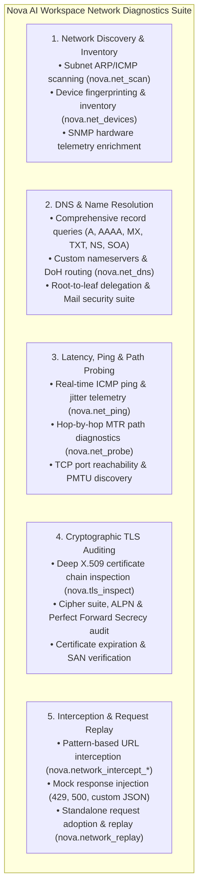
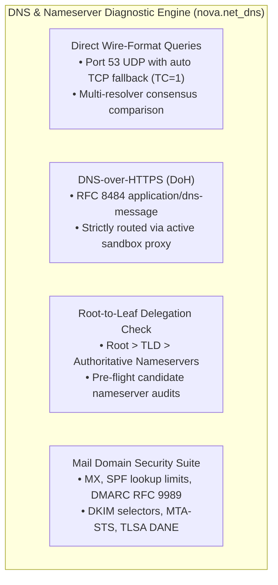
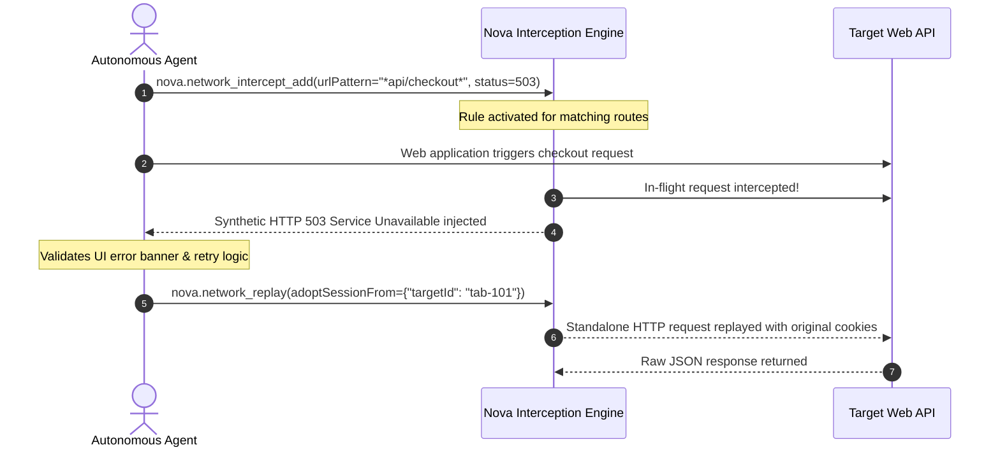

# Network Diagnostics, Probing & Proxy Management

> [!NOTE]
> Nova AI Workspace integrates a comprehensive, enterprise-grade network engineering and diagnostic suite directly into the browser shell. Designed for software developers, system administrators, and autonomous agents, it unifies subnet discovery, recursive DNS diagnostics, path probing, TLS certificate audits, in-flight HTTP interception, and multi-proxy routing without requiring external CLI utilities.

---

## 1. Overview & The Five Diagnostic Disciplines

Troubleshooting modern distributed applications often requires juggling multiple external terminal utilities (`ping`, `traceroute`, `dig`, `nmap`, `curl`, `mitmproxy`). This introduces friction, credential risks, and context fragmentation for both human operators and AI agents.

Nova eliminates this complexity by providing an in-engine **Network Engineering & Diagnostics Suite** organized into five complementary disciplines:



---

## 2. Subnet Scanning & Device Inventory

Nova allows operators and agents to discover active network devices and maintain a persistent, searchable local infrastructure catalog:

* **Subnet Scanning ([`nova.net_scan`](../../mcp-reference/tools/proxy-and-network/nova-net-scan.md)):** Scans IPv4 CIDR blocks (e.g., `192.168.1.0/24`) using non-disruptive ICMP echoes, TCP SYN probes, and ARP discovery.
  * Detects open ports, MAC vendor OIDs, and hostnames.
  * Automatically cross-references configured SNMP connectors to enrich devices with hardware model, vendor SMI numbers, and system uptime.
  * Real-time progress monitoring via [`nova.net_scan_status`](../../mcp-reference/tools/proxy-and-network/nova-net-scan-status.md) and cancellation via [`nova.net_scan_stop`](../../mcp-reference/tools/proxy-and-network/nova-net-scan-stop.md).
* **Device Inventory ([`nova.net_devices`](../../mcp-reference/tools/proxy-and-network/nova-net-devices.md)):** Queries the local SQLite inventory database. Filter devices by classification (e.g., `class="nas_storage"`), presence (`presence="seen"`), or custom label.
* **Metadata Enrichment ([`nova.net_devices_update`](../../mcp-reference/tools/proxy-and-network/nova-net-devices-update.md)):** Assign friendly display names, server roles, and asset tags to discovered hardware.

---

## 3. Deep DNS Diagnostics, Nameservers & Delegation Tracing ([`nova.net_dns`](../../mcp-reference/tools/proxy-and-network/nova-net-dns.md))

Domain resolution issues, misconfigured nameservers, broken DNSSEC chains, and unpropagated zone updates can lead to website outages or email delivery failures. Nova includes a native wire-format DNS diagnostic engine that runs without third-party dependencies, administrative privileges, or external command-line utilities.



### 3.1 Record Types & Multi-Resolver Consensus

Nova supports all essential DNS resource records and allows querying multiple public or private resolvers simultaneously to detect stale caches and global propagation drift:

* **Supported Record Types:** Query `A`, `AAAA`, `CNAME`, `MX` (mail exchange), `TXT` (SPF, verification tokens), `NS` (authoritative nameservers), `SOA` (start of authority, zone serials), `SRV` (service discovery), `CAA` (certificate issuance policies), and `PTR` (reverse DNS).
* **Multi-Resolver Comparison (`resolvers=[...]`):** Pass up to four resolvers simultaneously to compare propagation:
  * Named shortcuts: `"system"` (active Windows/VPN network adapters; default), `"cloudflare"` (`1.1.1.1`), `"google"` (`8.8.8.8`), and `"quad9"` (`9.9.9.9`).
  * Custom nameserver IP: Query specific authoritative or recursive nameservers directly by IP (e.g. `resolvers=["198.51.100.53"]`).
  * Consensus reporting: Records agreed upon by all resolvers appear once in the primary record set; any resolver returning diverging records or divergent SOA serials is highlighted in findings.
  * Smart CDN classification: Variations in `A`/`AAAA` IP addresses across resolvers are recognized as standard CDN/GeoDNS routing rather than reported as anomalies.

```json
{
  "name": "example.com",
  "types": ["A", "MX", "NS"],
  "resolvers": ["system", "cloudflare", "google"]
}
```

### 3.2 Wire-Format UDP/TCP vs. DNS-over-HTTPS (DoH)

Nova supports two distinct transport pathways configured via the `transport` parameter:

* **Native Wire-Format (`transport: "udp"`, default):**
  * Transmits raw binary RFC 1035 packets over UDP port 53 directly from the host network interface.
  * **Automatic TCP Truncation Handling:** If a response exceeds UDP payload limits and returns with the Truncation flag (`TC = 1`), Nova automatically opens a stream-oriented TCP port 53 connection to retrieve the complete, untruncated record set.
* **DNS-over-HTTPS (`transport: "doh"`):**
  * Encapsulates RFC 8484 wire messages inside encrypted HTTPS requests (`application/dns-message`).
  * **Strict Proxy Tunneling:** All DoH traffic strictly follows the active Nova proxy route assigned to the sandbox. When operating over corporate SOCKS5 or HTTPS tunnels, DoH queries traverse the tunnel, eliminating direct DNS leaks over local interfaces.
  * **Custom DoH URLs:** Pass any RFC 8484 compliant HTTPS endpoint in `resolvers` (e.g. `resolvers=["https://dns.example.net/dns-query"]`), which automatically enables DoH transport.

### 3.3 Root-to-Leaf Delegation Tracing (`checks: ["delegation"]`)

When migrating domains between DNS providers or troubleshooting "lame delegation" errors, standard recursive resolvers mask authoritative nameserver failures using cached glue and records. The delegation check bypasses all recursive caches and walks the full tree from the root down to the authoritative nameservers:

1. **Root Nameservers:** Interrogates global root servers (`a.root-servers.net` ... `m.root-servers.net`) to locate the authoritative servers for the Top-Level Domain (TLD).
2. **TLD Parent Zone:** Queries the parent registry (e.g., `.com`, `.org`, `.de` nameservers) to inspect parent-delegated `NS` records and Glue `A`/`AAAA` addresses.
3. **Zone Nameservers:** Directly contacts every designated authoritative nameserver over both UDP and TCP to verify:
   * Whether the server answers authoritatively (`AA = 1`) for the zone.
   * Whether SOA serial numbers and `NS` record sets match across all authoritative nodes.
   * Detection of **lame delegations** (nameservers listed in the parent zone that refuse or fail to answer for the domain).
   * Detection of missing glue records or servers that only reply over UDP while failing TCP handshakes.

### 3.4 Pre-Flight Migration Audits with Candidate Nameservers

Before updating nameserver delegation at your domain registrar, you can verify that the new DNS provider is fully configured, authoritative, and synchronized:

```json
{
  "name": "example.com",
  "checks": ["delegation"],
  "candidateNameservers": [
    { "host": "ns1.newhost.net", "address": "198.51.100.1" },
    { "host": "ns2.newhost.net", "address": "198.51.100.2" }
  ]
}
```

Nova probes each candidate nameserver alongside existing delegated servers, comparing SOA serials, record sets, and authoritative flags before the registrar cutover, preventing migration downtime.

### 3.5 DNSSEC Validation & Key Rollover Auditing

Within the delegation audit, Nova analyzes the cryptographic DNSSEC chain of custody:
* Verifies whether parent `DS` (Delegation Signer) records match active `DNSKEY` records published by the authoritative zone.
* Detects dangerous configuration mismatches (e.g., a parent publishing a `DS` record while the zone has removed its DNSSEC keys, which causes validating resolvers like Google and Cloudflare to return `SERVFAIL` for all clients).
* Checks `RRSIG` signature validity windows, alerting operators to expired signatures or signatures scheduled to expire within 24 hours.

### 3.6 Mail Domain Security Suite (`checks: ["mail"]`)

Diagnose why outgoing emails land in spam folders or verify spoofing protections:

* **MX Record Integrity:** Audits mail exchange hosts, null MX declarations (RFC 7505; domains that explicitly reject email), CNAME anti-patterns in MX records, and DANE TLSA authentic records.
* **SPF (Sender Policy Framework):** Evaluates SPF syntax like a receiving mail server, counting recursive DNS lookups against the strict RFC 7208 **10-lookup limit**, identifying include loops, void lookups, and insecure `+all` wildcards.
* **DMARC Compliance (RFC 9989):** Identifies organizational domain policy inheritance, alignment modes, active policy (`none`, `quarantine`, `reject`), and unauthorized aggregate reporting (`rua`) destinations.
* **DKIM Selector Verification:** Pass specific selector tags via `dkimSelectors=["selector1", "google"]` or audit standard provider selectors, checking public key lengths (flagging weak 1024-bit RSA keys) and revocation markers.
* **Modern Standards:** Audits MTA-STS (`_mta-sts` TXT and policy hosts), TLS-RPT (`_smtp._tls`), and BIMI (`default._bimi`) brand indicator records.

### 3.7 Reverse DNS (PTR) & Private Intranet Protection

* **Reverse DNS Lookups:** Supply an IPv4 or IPv6 address directly as the `name` parameter (e.g. `name="198.51.100.25"`). Nova constructs the appropriate `in-addr.arpa` or `ip6.arpa` query, retrieves PTR records, and performs forward-confirmed reverse DNS (FCrDNS) checks.
* **Intranet Leak Safeguards:** Nova automatically protects internal network topology. Single-label names, internal private domains (`.local`, `.internal`, `.lan`, `.corp`, `.home.arpa`), and RFC 1918 private IP addresses are never transmitted to public external resolvers.

---

## 4. Latency, Ping & Path Diagnostics

### 4.1 Real-Time ICMP Ping ([`nova.net_ping`](../../mcp-reference/tools/proxy-and-network/nova-net-ping.md))

Audit host reachability and network stability with millisecond precision:
* **Metrics:** Measures minimum, maximum, and average Round-Trip Time (RTT), standard deviation, and packet loss percentage.
* **Configurable Controls:** Tune packet count (`count`), ping timeout (`timeoutMs`), payload size (`packetSizeBytes`), and packet Time-To-Live (`ttl`).

### 4.2 Hop-by-Hop Path Probing & MTR Diagnostics ([`nova.net_probe`](../../mcp-reference/tools/proxy-and-network/nova-net-probe.md))

Isolate routing bottlenecks, packet loss hops, and firewall boundaries between your workstation and target endpoints:
* **Target Port Auditing:** Audit open TCP ports across target hosts (`tcpPorts=[22, 80, 443, 8080]`).
* **Path Tracing (MTR):** Performs incremental TTL path discovery, reporting each intermediate router hop, IP address, hostname, and per-hop latency.
* **Path MTU Discovery (PMTU):** Detects maximum transmission unit bottlenecks and fragmented packet drops along the path.

---

## 5. Cryptographic TLS/SSL Auditing ([`nova.tls_inspect`](../../mcp-reference/tools/proxy-and-network/nova-tls-inspect.md))

Verify the security and certificate validity of HTTPS endpoints before transmitting credentials or sensitive data:

* **X.509 Certificate Chain Inspection:** Audits server public certificates, intermediate certificate authorities, and root anchors. Reports validity start/end timestamps, days until expiration, and serial numbers.
* **Subject Alternative Names (SANs):** Verifies all covered domains and wildcards (e.g. `*.example.com`).
* **Protocol & Cipher Suite Negotiation:** Reports the negotiated TLS version (TLS 1.2, TLS 1.3), key exchange mechanism, cipher suite (e.g. `TLS_AES_256_GCM_SHA384`), and Perfect Forward Secrecy (PFS) support.
* **ALPN Negotiation:** Inspects negotiated Application-Layer Protocol Negotiation (HTTP/2, HTTP/3, HTTP/1.1).

---

## 6. In-Flight HTTP Interception & Standalone Replay

Simulate backend failures, test frontend error handling, and replay API requests without browser DevTools:



* **Rule-Based Interception ([`nova.network_intercept_add`](../../mcp-reference/tools/proxy-and-network/nova-network-intercept-add.md)):** Intercept requests matching exact URLs or wildcards. Inject synthetic status codes (`status=500`, `status=503`, `status=429`) or mock JSON payloads.
* **Rule Governance:** List active rules with [`nova.network_intercept_list`](../../mcp-reference/tools/proxy-and-network/nova-network-intercept-list.md) and purge interceptors with [`nova.network_intercept_clear`](../../mcp-reference/tools/proxy-and-network/nova-network-intercept-clear.md).
* **Standalone Replay ([`nova.network_replay`](../../mcp-reference/tools/proxy-and-network/nova-network-replay.md)):** Adopt authenticated sessions from active tabs (`adoptSessionFrom={"targetId": "active"}`) to execute standalone HTTP requests, inspecting raw response headers and payloads without browser page reloads.

---

## 7. Multi-Proxy Routing & Profile Switching

Nova provides native support for routing network traffic through SOCKS5, HTTP, and HTTPS proxies per sandbox profile:

* **Profile Management:** Configure proxy endpoints, ports, and authentication credentials in **Settings → Network & Proxies** or via [`nova.proxy_create`](../../mcp-reference/tools/proxy-and-network/nova-proxy-create.md) / [`nova.proxy_update`](../../mcp-reference/tools/proxy-and-network/nova-proxy-update.md).
* **Dynamic Sandbox Switching:** Instantly switch the active proxy profile for a sandbox via [`nova.proxy_switch`](../../mcp-reference/tools/proxy-and-network/nova-proxy-switch.md) without restarting the browser.
* **Health & Latency Testing:** Verify proxy availability and measured handshake latency using [`nova.proxy_test`](../../mcp-reference/tools/proxy-and-network/nova-proxy-test.md).

---

## 8. Summary Tool Matrix

| Discipline | MCP Tools | Key Capabilities |
| :--- | :--- | :--- |
| **Discovery & Inventory** | [`nova.net_scan`](../../mcp-reference/tools/proxy-and-network/nova-net-scan.md)<br>[`nova.net_devices`](../../mcp-reference/tools/proxy-and-network/nova-net-devices.md)<br>[`nova.net_devices_update`](../../mcp-reference/tools/proxy-and-network/nova-net-devices-update.md) | Subnet IP/ARP scanning, MAC OID lookup, device categorization, and SNMP enrichment. |
| **DNS Diagnostics** | [`nova.net_dns`](../../mcp-reference/tools/proxy-and-network/nova-net-dns.md) | Recursive queries, DoH proxy routing, root-to-leaf delegation, candidate nameservers, DNSSEC, and mail security suite. |
| **Path & Latency** | [`nova.net_ping`](../../mcp-reference/tools/proxy-and-network/nova-net-ping.md)<br>[`nova.net_probe`](../../mcp-reference/tools/proxy-and-network/nova-net-probe.md) | Millisecond ICMP ping, packet loss statistics, hop-by-hop MTR path discovery, and TCP port checks. |
| **TLS/SSL Inspection** | [`nova.tls_inspect`](../../mcp-reference/tools/proxy-and-network/nova-tls-inspect.md) | X.509 certificate chains, cipher suites, expiration warnings, and SAN domain verification. |
| **Interception & Replay** | [`nova.network_intercept_add`](../../mcp-reference/tools/proxy-and-network/nova-network-intercept-add.md)<br>[`nova.network_replay`](../../mcp-reference/tools/proxy-and-network/nova-network-replay.md) | HTTP status injection (503/429), pattern interception, and standalone cookie-authenticated request replay. |
| **Proxy Management** | [`nova.proxy_switch`](../../mcp-reference/tools/proxy-and-network/nova-proxy-switch.md)<br>[`nova.proxy_list`](../../mcp-reference/tools/proxy-and-network/nova-proxy-list.md)<br>[`nova.proxy_test`](../../mcp-reference/tools/proxy-and-network/nova-proxy-test.md) | Dynamic proxy routing per sandbox, credential-backed SOCKS5/HTTP profiles, and latency testing. |

---

## 9. Related Documentation

* **[Network Architecture Hub](../../core-features/network/README.md)** — Architectural specification for all 5 network disciplines.
* **[Network Discovery & Inventory Architecture](../../core-features/network/network-discovery-and-inventory/README.md)** — In-depth discovery pipelines.
* **[DNS Diagnostics Architecture](../../core-features/network/dns-diagnostics/README.md)** — DNS resolution mechanics and resolver fallbacks.
* **[Path Diagnostics & Probing Architecture](../../core-features/network/path-diagnostics-and-probing/README.md)** — Path discovery, MTR, and PMTU.
* **[Settings Guide: Network & Proxies](../settings/network-and-proxies.md)** — Desktop UI instructions for configuring proxy profiles and DNS governance.
* **[Remote Connectors Guide](connectors.md)** — SSH command execution and remote database management.

---

[Back to Workspace Tools](README.md) · [All user guides](../README.md)
