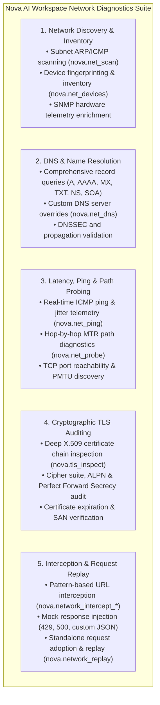
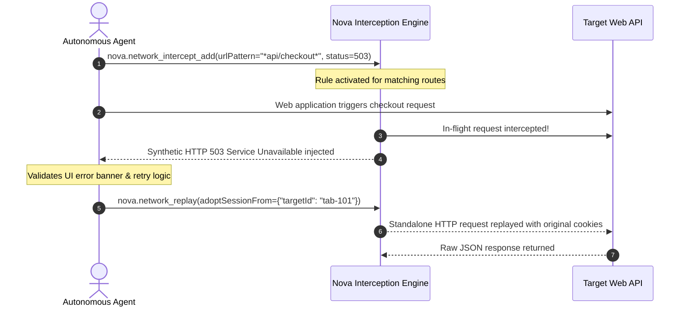

# Network Diagnostics, Probing & Proxy Management

> [!NOTE]
> Nova AI Workspace integrates a comprehensive, enterprise-grade network engineering and diagnostic suite directly into the browser shell. Designed for software developers, system administrators, and autonomous agents, it unifies subnet discovery, recursive DNS diagnostics, path probing, TLS certificate audits, in-flight HTTP interception, and multi-proxy routing without requiring external CLI utilities.

---

## 1. Overview & The Five Diagnostic Disciplines

Troubleshooting modern distributed applications often requires juggling multiple external terminal utilities (`ping`, `traceroute`, `dig`, `nmap`, `curl`, `mitmproxy`). This introduces friction, credential risks, and context fragmentation for both human operators and AI agents.

Nova eliminates this complexity by providing an in-engine **Network Engineering & Diagnostics Suite** organized into five complementary disciplines:

---

## 2. Subnet Scanning & Device Inventory

Nova allows operators and agents to discover active network devices and maintain a persistent, searchable local infrastructure catalog:

* **Subnet Scanning (`nova.net_scan`):** Scans IPv4 CIDR blocks (e.g., `192.168.1.0/24`) using non-disruptive ICMP echoes, TCP SYN probes, and ARP discovery.
  * Detects open ports, MAC vendor OIDs, and hostnames.
  * Automatically cross-references configured SNMP connectors to enrich devices with hardware model, vendor SMI numbers, and system uptime.
  * Real-time progress monitoring via `nova.net_scan_status` and cancellation via `nova.net_scan_stop`.
* **Device Inventory (`nova.net_devices`):** Queries the local SQLite inventory database. Filter devices by classification (e.g., `class="nas_storage"`), presence (`presence="seen"`), or custom label.
* **Metadata Enrichment (`nova.net_devices_update`):** Assign friendly display names, server roles, and asset tags to discovered hardware.

---

## 3. Deep DNS Diagnostics & Name Resolution (`nova.net_dns`)

Diagnose domain resolution failures, email routing records, and security headers directly from Nova:

* **Supported Record Types:** Query `A`, `AAAA`, `CNAME`, `MX` (mail routing), `TXT` (SPF, DKIM, DMARC), `NS` (name servers), `SOA` (start of authority), `SRV` (service discovery), and `PTR` (reverse DNS lookups).
* **Custom Resolver Overrides:** Query specific external or internal DNS resolvers (e.g. `server="8.8.8.8"`, `server="1.1.1.1"`, or internal corporate nameservers) to bypass local Windows DNS cache and verify global propagation delays.
* **Diagnostic Telemetry:** Reports authoritative answers, recursion flags, TTL caching lifetimes, and detailed response codes (`NOERROR`, `NXDOMAIN`, `SERVFAIL`).

---

## 4. Latency, Ping & Path Diagnostics

### 4.1 Real-Time ICMP Ping (`nova.net_ping`)

Audit host reachability and network stability with millisecond precision:
* **Metrics:** Measures minimum, maximum, and average Round-Trip Time (RTT), standard deviation, and packet loss percentage.
* **Configurable Controls:** Tune packet count (`count`), ping timeout (`timeoutMs`), payload size (`packetSizeBytes`), and packet Time-To-Live (`ttl`).

### 4.2 Hop-by-Hop Path Probing & MTR Diagnostics (`nova.net_probe`)

Isolate routing bottlenecks, packet loss hops, and firewall boundaries between your workstation and target endpoints:
* **Target Port Auditing:** Audit open TCP ports across target hosts (`tcpPorts=[22, 80, 443, 8080]`).
* **Path Tracing (MTR):** Performs incremental TTL path discovery, reporting each intermediate router hop, IP address, hostname, and per-hop latency.
* **Path MTU Discovery (PMTU):** Detects maximum transmission unit bottlenecks and fragmented packet drops along the path.

---

## 5. Cryptographic TLS/SSL Auditing (`nova.tls_inspect`)

Verify the security and certificate validity of HTTPS endpoints before transmitting credentials or sensitive data:

* **X.509 Certificate Chain Inspection:** Audits server public certificates, intermediate certificate authorities, and root anchors. Reports validity start/end timestamps, days until expiration, and serial numbers.
* **Subject Alternative Names (SANs):** Verifies all covered domains and wildcards (e.g. `*.example.com`).
* **Protocol & Cipher Suite Negotiation:** Reports the negotiated TLS version (TLS 1.2, TLS 1.3), key exchange mechanism, cipher suite (e.g. `TLS_AES_256_GCM_SHA384`), and Perfect Forward Secrecy (PFS) support.
* **ALPN Negotiation:** Inspects negotiated Application-Layer Protocol Negotiation (HTTP/2, HTTP/3, HTTP/1.1).

---

## 6. In-Flight HTTP Interception & Standalone Replay

Simulate backend failures, test frontend error handling, and replay API requests without browser DevTools:

* **Rule-Based Interception (`nova.network_intercept_add`):** Intercept requests matching exact URLs or wildcards. Inject synthetic status codes (`status=500`, `status=503`, `status=429`) or mock JSON payloads.
* **Rule Governance:** List active rules with `nova.network_intercept_list` and purge interceptors with `nova.network_intercept_clear`.
* **Standalone Replay (`nova.network_replay`):** Adopt authenticated sessions from active tabs (`adoptSessionFrom={"targetId": "active"}`) to execute standalone HTTP requests, inspecting raw response headers and payloads without browser page reloads.

---

## 7. Multi-Proxy Routing & Profile Switching

Nova provides native support for routing network traffic through SOCKS5, HTTP, and HTTPS proxies per sandbox profile:

* **Profile Management:** Configure proxy endpoints, ports, and authentication credentials in **Settings → Network & Proxies** or via `nova.proxy_create` / `nova.proxy_update`.
* **Dynamic Sandbox Switching:** Instantly switch the active proxy profile for a sandbox via `nova.proxy_switch(profileId="proxy-dev")` without restarting the browser.
* **Health & Latency Testing:** Verify proxy availability and measured handshake latency using `nova.proxy_test`.

---

## 8. Summary Tool Matrix

| Discipline | MCP Tools | Key Capabilities |
| :--- | :--- | :--- |
| **Discovery & Inventory** | [`nova.net_scan`](../../mcp-reference/tools/proxy-and-network/nova-net-scan.md) [`nova.net_devices`](../../mcp-reference/tools/proxy-and-network/nova-net-devices.md) [`nova.net_devices_update`](../../mcp-reference/tools/proxy-and-network/nova-net-devices-update.md) | Subnet IP/ARP scanning, MAC OID lookup, device categorization, and SNMP enrichment. |
| **DNS Diagnostics** | [`nova.net_dns`](../../mcp-reference/tools/proxy-and-network/nova-net-dns.md) | Recursive record queries (`A`, `AAAA`, `MX`, `TXT`, `NS`), custom nameservers, and propagation audits. |
| **Path & Latency** | [`nova.net_ping`](../../mcp-reference/tools/proxy-and-network/nova-net-ping.md) [`nova.net_probe`](../../mcp-reference/tools/proxy-and-network/nova-net-probe.md) | Millisecond ICMP ping, packet loss statistics, hop-by-hop MTR path discovery, and TCP port checks. |
| **TLS/SSL Inspection** | [`nova.tls_inspect`](../../mcp-reference/tools/proxy-and-network/nova-tls-inspect.md) | X.509 certificate chains, cipher suites, expiration warnings, and SAN domain verification. |
| **Interception & Replay** | [`nova.network_intercept_add`](../../mcp-reference/tools/proxy-and-network/nova-network-intercept-add.md) [`nova.network_replay`](../../mcp-reference/tools/proxy-and-network/nova-network-replay.md) | HTTP status injection (503/429), pattern interception, and standalone cookie-authenticated request replay. |
| **Proxy Management** | [`nova.proxy_switch`](../../mcp-reference/tools/proxy-and-network/nova-proxy-switch.md) [`nova.proxy_list`](../../mcp-reference/tools/proxy-and-network/nova-proxy-list.md) [`nova.proxy_test`](../../mcp-reference/tools/proxy-and-network/nova-proxy-test.md) | Dynamic proxy routing per sandbox, credential-backed SOCKS5/HTTP profiles, and latency testing. |

---

## 9. Related Documentation

* **[Network Architecture Hub](../../core-features/network/README.md)** — Architectural specification for all 5 network disciplines.
* **[Network Discovery & Inventory Architecture](../../core-features/network/network-discovery-and-inventory/README.md)** — In-depth discovery pipelines.
* **[DNS Diagnostics Architecture](../../core-features/network/dns-diagnostics/README.md)** — DNS resolution mechanics and resolver fallbacks.
* **[Path Diagnostics & Probing Architecture](../../core-features/network/path-diagnostics-and-probing/README.md)** — Path discovery, MTR, and PMTU.
* **[Settings Guide: Network & Proxies](../settings/network-and-proxies.md)** — Desktop UI instructions for configuring proxy profiles.
* **[Remote Connectors Guide](connectors.md)** — SSH command execution and remote database management.

[Back to Workspace Tools](README.md) · [All user guides](../README.md)
