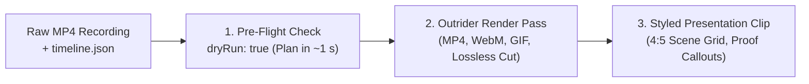

# Session Recordings & Time-Travel Debugging

> [!NOTE]
> Nova AI Workspace includes a forensic **Session Recording** engine designed for developers, QA testers, and AI agents. It captures high-fidelity event streams within browser tabs—including network traffic, console output, JavaScript exceptions, user/agent clicks, and DOM snapshots—allowing you to diagnose complex failures post-mortem without re-running destructive actions.

---

## 1. What Is Session Recording?

When an automated workflow fails, a web application throws an unexpected error, or a form submission silently breaks, traditional logs rarely explain *why*. Session Recording acts like a tamper-resistant black box flight recorder for web browsing:

* **Complete Event Streams:** Captures network request headers and bodies, DevTools console messages, unhandled promise rejections, window resizing, navigation history, and DOM mutations.
* **Correlated Interactions:** Maps exact physical and simulated clicks, keyboard inputs, and scrolls directly to the resulting network responses and DOM state changes.
* **Capture-Time Secret Redaction:** Passwords, authentication headers (`Authorization: Bearer ...`), API keys, and DPAPI-stored credentials are automatically masked *before* writing to disk.
* **Encrypted Storage:** Recordings are written as line-by-line **AES-256-GCM** encrypted streams (`.jsonl`), with data encryption keys (DEK) protected by the Windows Data Protection API (DPAPI).

```
+-----------------------------------------------------------------------------------+
|  [A: Work] [Tab 1: Checkout (REC)] [+]                                   [_][O][X]|
+-----------------------------------------------------------------------------------+
|  [<-] [->] [Reload] | https://app.example.com/checkout  [REC Active] | [Menu]     |
+-----------------------------------------------------------------------------------+
|                                                                                   |
|  Active Recording: rec-9b41a82f                                                  |
|  Status: Recording (00:02:14 elapsed, 142 events, 3.4 MB)                        |
|                                                                                   |
|  Captured Streams:                                                                |
|  * [x] Network requests (38 captured, authorization masked)                      |
|  * [x] Console output & runtime errors (2 errors detected)                        |
|  * [x] User and Agent interactions (14 clicks, 2 form fills)                      |
|  * [x] DOM snapshots (4 automatic keyframe captures)                             |
|                                                                                   |
|  Actions: [ Pause ]  [ Snapshot DOM Now ]  [ Stop & Save ]  [ Export .novarec ]   |
+-----------------------------------------------------------------------------------+
```

---

## 2. Starting & Stopping Recordings

### Starting a Recording
1. **From the Main Menu:** Select **Menu → Tools → Start session recording**.
2. **From the Tab Context Menu:** Right-click any active tab and select **Record tab activity**.
3. **Agent-Initiated:** Autonomous AI agents can start recordings programmatically before executing sensitive or multi-step operations using [`nova.session_record_start`](../../mcp-reference/tools/session-recording/nova-session-record-start.md).

### Live Visual Indicators
* **Tab Strip Indicator:** An active recording tab displays a distinct red recording badge `(REC)` directly beside its favicon.
* **URL Bar Badge:** The status section of the address bar shows an active **Recording** chip. Clicking this badge opens the quick-control flyout to view live event counts, trigger an immediate DOM snapshot, or stop the recording.

### Stopping a Recording
* Click the recording chip in the URL bar and select **Stop & Save**, or select **Menu → Tools → Stop session recording**.
* The recording session is sealed, its encryption keys are committed, and its manifest is indexed in the local session database.

---

## 3. Investigating Failures Post-Mortem

Once a session is recorded, you and your AI agents can inspect it without mutating the live webpage or re-submitting transactions:

### 1. Correlating Interactions with Network Failures
* Review the chronological timeline of actions. For example, locate the exact timestamp when the `#submit-order` button was clicked.
* Inspect the outgoing `POST /api/v1/orders` request immediately following that click. Inspect response status codes (e.g. `500 Internal Server Error`), payload sizes, and server error bodies.

### 2. Identifying Silent JavaScript Errors
* Filter the event stream for `errors.jsonl` and `console.jsonl`.
* Inspect client-side exceptions (such as `Uncaught TypeError: Cannot read properties of undefined`) that prevented UI updates even when network requests succeeded.

### 3. Reviewing DOM Snapshots
* Nova automatically captures a complete DOM snapshot immediately before and after significant interactions.
* Inspect DOM snapshots to see whether form fields had CSS validation error classes (`.is-invalid`), whether hidden modal dialogs were obscuring buttons, or whether disabled attributes were present.

---

## 4. Privacy, Security & Quota Controls

Session recordings capture extensive data. Nova provides comprehensive privacy protections configurable in **Menu → Settings → Session recording**:

* **Master Switch:** Enable or disable session recording globally. When disabled, all recording attempts (including agent MCP calls) are blocked.
* **Toolbar Indicator:** Toggle whether the recording indicator is visible in the window chrome.
* **Storage Quota:** Configure the maximum disk space allocated for recordings (e.g. `1024 MB`). When the quota is reached, oldest recordings are automatically pruned.
* **Auto-Purge Retention:** Automatically purge recordings older than a specified number of days (e.g. `7 days`).
* **Concurrent Recordings Limit:** Prevent performance degradation by limiting how many tabs can record simultaneously (default: `2`).
* **Permission Classes:** Selectively enable or disable specific event streams:
  * *Network CDP:* Network headers and payloads.
  * *Console & Errors:* Developer console and runtime crashes.
  * *Interactions:* Clicks, scrolls, and key presses.
  * *DOM Snapshots:* Full-page structural snapshots.

---

## 5. Exporting & Sharing Recordings

* **Export Archive:** In the recording manager, select **Export recording** to package the encrypted session into a portable `.novarec` archive.
* **Sanitized Audit Export:** Export a redacted JSON summary containing timing, request URLs, and error messages for bug reports without embedding confidential session state.

---

## 6. Screen Video Recording & Timeline Visual Assertions

In addition to tab-scoped event streams, Nova includes a hardware-accelerated **Screen Video Recording** engine designed for capturing live visual evidence, creating demo videos, and validating visual UI assertions:

* **Starting & Stopping Screen Videos:**
  * Agents initiate window video capture using [`nova.screen_record_start`](../../mcp-reference/tools/visual-evidence/nova-screen-record-start.md).
  * Video is encoded directly to an MP4 container in Nova's isolated helper process with zero impact on browser responsiveness.
  * Check live recording state with [`nova.screen_record_status`](../../mcp-reference/tools/visual-evidence/nova-screen-record-status.md) and finalize the video with [`nova.screen_record_stop`](../../mcp-reference/tools/visual-evidence/nova-screen-record-stop.md).
* **Marking Timeline Checkpoints (`nova.screen_record_mark`):**
  * When a key event occurs during automation (e.g. navigation starts, a modal opens, or an error banner renders), the agent can mark the moment on the video timeline.
  * Each mark saves a lossless keyframe image and timestamps the timeline for easy post-mortem navigation.
* **Automated Visual Assertions (`nova.screen_record_assert`):**
  * Agents frequently need to verify time-sensitive visual claims, such as *"the confirmation banner appears within two seconds"* or *"the checkout spinner disappears after clicking submit"*.
  * [`nova.screen_record_assert`](../../mcp-reference/tools/visual-evidence/nova-screen-record-assert.md) continuously checks the visual claim against running video frames.
  * It records whether the assertion passed or failed, measures the exact elapsed time, and places the result on the video's timeline accompanied by a keyframe image.
* **Timeline Inspection & Contact Sheets (`nova.screen_record_inspect`):**
  * Once a screen recording is complete, agents inspect the visual evidence without re-watching the video.
  * Returns an executive summary, duration, marked timestamps, visual assertion results, and an assembled multi-frame contact sheet.

---

## 7. Video Composition, Editing & Template Rendering (`nova.video_render`)

Raw screen recordings frequently capture idle delays, pauses, or off-target window areas that distract human reviewers. Nova includes an on-device video editing engine that transforms raw recordings into concise, branded presentation clips:



### 1. Automated Storytelling from Timeline Marks (`fromMarks: true`)
Rather than calculating manual millisecond cuts, agents instruct Nova to construct the narrative directly from chronological timeline markers dropped during execution:
```json
{
  "name": "nova.video_render",
  "arguments": {
    "template": "nova-linkedin",
    "fromMarks": true,
    "resultCard": {
      "title": "Quarterly Reconciled",
      "sourceLabel": "Source ERP",
      "targetLabel": "Live Portal"
    },
    "endCard": {
      "text": "Audit Complete.\nZero Discrepancies.",
      "cta": "Explore Report"
    }
  }
}
```
* **Opening Hook:** Markers with `role: "task"` automatically establish the opening chapter, playing for exactly 1.8 seconds.
* **Mutation Synchronization:** Markers with `role: "step"` bind backwards up to 5,000 ms to the preceding visual DOM mutation ($\ge 25\%$ area), revealing the step text as the page settles.
* **Semantic Verification:** Concluding chapters (`role: "result"`) are highlighted in semantic green (`#55D6A4`) only if every UI check in the run passed.

### 2. Visual Proof Effects (`proofFocus`) & Automatic Pacing (`proofPace`)
* **Focus Highlighting:** Verified UI assertions dim the surrounding screen with a dark veil (`#0A0D14` at 50% opacity), spotlighting the exact DOM element box.
* **Dynamic Morphing:** Consecutive checks within 2.5 seconds morph smoothly between elements in 200 ms, followed by an authoritative green checkmark ($\checkmark$) 133 ms after settlement.
* **Human-Readable Pacing:** `proofPace: true` ensures that rapid automated checks are held for ~650 ms per item and 1,200 ms on the final check, making high-speed agent interactions easy to follow on video.

### 3. Pre-Flight Dry Runs (`dryRun: true`)
Before committing to full video rendering, agents test timing, font sizes, contrast, and layout constraints using `dryRun: true`:
* Compiles the editorial plan and verifies all material and render checks in approximately 1 second.
* Returns `{ ok, plan, durationMs, checks, segments }` without decoding frames or writing output files.

### 4. Lossless Stream Cuts (`lossless: true`)
When preparing bug reports or minimal reproduction attachments:
* Setting `lossless: true` with `format: "mp4"` triggers an instantaneous keyframe stream copy via `Mp4Remux`.
* Retains original H.264 video bytes and synchronized AAC audio with zero re-encoding loss.

---

## 8. AI Agent Integration

AI coding agents leverage session, screen recording, and video rendering tools for self-verification, visual assertions, and automated reporting:

* **Session Event Tools:**
  * [`nova.session_record_start`](../../mcp-reference/tools/session-recording/nova-session-record-start.md): Begins recording a target tab with custom permission classes.
  * [`nova.session_record_query`](../../mcp-reference/tools/session-recording/nova-session-record-query.md): Queries captured events with filtering by timestamp, event type, and status code.
  * [`nova.session_record_interactions`](../../mcp-reference/tools/session-recording/nova-session-record-interactions.md): Lists user and agent clicks, inputs, and element targets.
  * [`nova.session_record_dom_snapshot`](../../mcp-reference/tools/session-recording/nova-session-record-dom-snapshot.md): Retrieves complete serialized DOM keyframes.
  * [`nova.session_record_stop`](../../mcp-reference/tools/session-recording/nova-session-record-stop.md): Finalizes the recording session.
* **Visual Evidence & Screen Video Tools:**
  * [`nova.screen_record_start`](../../mcp-reference/tools/visual-evidence/nova-screen-record-start.md): Launches a video capture of the Nova browser window.
  * [`nova.screen_record_mark`](../../mcp-reference/tools/visual-evidence/nova-screen-record-mark.md): Places a timestamped marker with a lossless frame snapshot.
  * [`nova.screen_record_assert`](../../mcp-reference/tools/visual-evidence/nova-screen-record-assert.md): Evaluates visual UI assertions against running frames.
  * [`nova.screen_record_inspect`](../../mcp-reference/tools/visual-evidence/nova-screen-record-inspect.md): Retrieves the timeline, assertion logs, and contact sheet.
  * [`nova.screen_record_stop`](../../mcp-reference/tools/visual-evidence/nova-screen-record-stop.md): Finalizes the screen recording.
* **Video Composition & Rendering Tools:**
  * [`nova.video_render`](../../mcp-reference/tools/video-editing/nova-video-render.md): Compiles screen recordings into styled MP4, WebM, or GIF presentation clips, contact sheets, or lossless cuts.
  * [`nova.video_template_list`](../../mcp-reference/tools/video-editing/nova-video-template-list.md): Lists all built-in and user-saved video rendering presets.
  * [`nova.video_template_save`](../../mcp-reference/tools/video-editing/nova-video-template-save.md): Saves reusable aspect ratio, speed, and styling templates.
  * [`nova.video_template_delete`](../../mcp-reference/tools/video-editing/nova-video-template-delete.md): Deletes custom video templates.

---

## 9. Related Documentation

* **[Programmatic Video Editing Architecture](../../core-features/media-intelligence/video-editing/README.md)** — In-depth architectural details of Outrider video rendering, scene grids, and camera pacing.
* **[Core Features: Session Recording](../../core-features/session-recording/README.md)** — Architectural details, encryption mechanics, and event stream formats.
* **[Video Editing Tools Reference](../../mcp-reference/tools/video-editing/README.md)** — Parameter specifications and template catalog.
* **[Visual Evidence Tools Reference](../../mcp-reference/tools/visual-evidence/README.md)** — Screenshots, visual diffs, and screen video tools.
* **[Tools Overview](README.md)** — Master hub for all built-in workspace utilities.
* **[Agent Awareness Gates](../../core-features/agent-awareness-gates-aag/README.md)** — Safety boundaries for agent-initiated operations.
