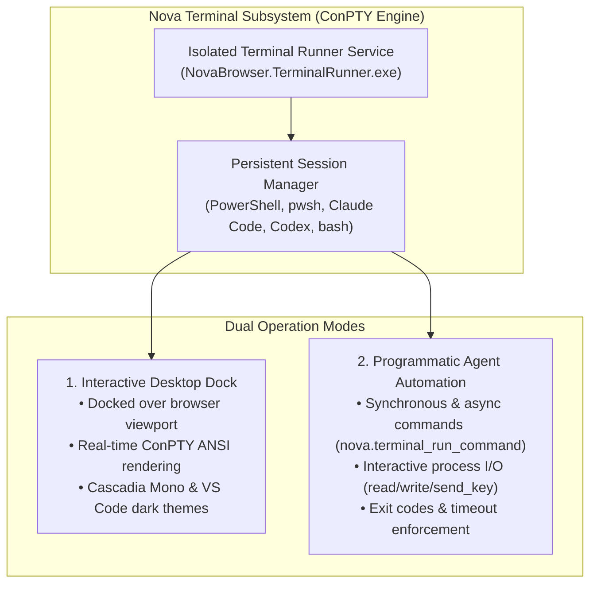

# Integrated Terminal Dock & ConPTY Automation

> [!NOTE]
> Nova AI Workspace embeds a full Windows pseudo console (ConPTY) terminal engine directly inside the browser shell. It operates as an interactive dock side-by-side with web pages for human developers and exposes a high-performance programmatic terminal execution suite for connected AI agents.

---

## 1. Overview & Dual-Mode Architecture

During development, deployment, or automated web testing, switching back and forth between standalone terminal emulators and browser windows fragments context. Nova eliminates this friction by integrating a native Windows pseudo console (ConPTY) environment directly into the browser layout.

The terminal subsystem operates in two complementary modes:



* **Interactive Human Dock:** Run PowerShell 7, Windows PowerShell, Claude Code, Codex, or custom CLI scripts in a flexible dock positioned over the active webpage.
* **Autonomous Agent Automation:** Connected agents can spawn independent terminal sessions, run build scripts, start local development servers, and inspect console outputs without human intervention.
* **Background Process Durability:** The terminal runner executes in a separate background service. Compilations, test runners, and dev servers continue running uninterrupted when the dock is collapsed or hidden.

---

## 2. Desktop Dock Layout & Controls

Open the terminal dock anytime by clicking the **Terminal** button in the main toolbar or using the keyboard shortcut:

```
+-----------------------------------------------------------------------------------+
|  [ Work (Blue) ] [ Personal ] [+] | [Tab 1: Localhost:3000] [Tab 2] [+] [_] [O] [X] |
+-----------------------------------------------------------------------------------+
|  Active Web Application (Live Viewport)                                           |
|                                                                                   |
|  +-----------------------------------------------------------------------------+  |
|  | [=] Workspaces: [Default (pwsh)] [API Server] [+] | [-] Collapse [X] Close   |  |
|  +-----------------------------------------------------------------------------+  |
|  | PS E:\dev\web-app> npm run dev                                              |  |
|  | > web-app@1.0.0 dev                                                         |  |
|  | > next dev                                                                  |  |
|  | - ready started server on 0.0.0.0:3000, url: http://localhost:3000          |  |
|  +-----------------------------------------------------------------------------+  |
+-----------------------------------------------------------------------------------+
```

### 2.1 The Three Dock Modes

| Mode | Trigger | Behavior |
| :--- | :--- | :--- |
| **Expanded** | Click **Terminal** toolbar button | Displays the interactive terminal console over the lower portion of the viewport. |
| **Collapsed** | Click **Collapse to tab strip** | Minimizes the dock to a compact tab strip above the page while processes continue running. Double-click the strip or drag the handle to expand. |
| **Hidden** | Click **Hide terminal** or close | Hides the dock entirely. Background sessions remain active in memory. |

* **Detached Windows:** Click **Open in a separate window** on any terminal tab to pop the session out into an independent, multi-monitor desktop window.
* **Visual Pulse Activity:** When background processes produce output (e.g., test suites finishing or compilers logging errors), a subtle green dot pulses on the terminal tab.

---

## 3. Workspaces & Environment Credentials

The terminal dock organizes execution environments into named **Workspaces**:

* **New Workspace:** Click `+` to create a dedicated environment with a custom **Workspace name** and **Working directory** (`cwd`).
* **Shell Selection:** Choose from detected shell installations:
  * PowerShell 7 (`pwsh.exe`) or Windows PowerShell (`powershell.exe`).
  * Command Prompt (`cmd.exe`).
  * Dedicated AI coding agents: **Claude Code** or **Codex**.
  * Custom commands with predefined parameters (e.g., `claude --model opus`).
* **Scoped Environment Credentials:** Under **Settings → Tools → Credentials & keys**, store API tokens and private environment variables. Pass them selectively to designated terminal workspaces without exposing them system-wide.

---

## 4. Programmatic Agent Automation over MCP

AI agents interact with the terminal engine through Nova's Model Context Protocol (MCP) tool suite:

### 4.1 Running Commands ([`nova.terminal_run_command`](../../mcp-reference/tools/terminal-ops/nova-terminal-run-command.md))

Execute a command inside an existing terminal session, waiting for execution to finish and capturing the output:

```json
{
  "name": "nova.terminal_run_command",
  "arguments": {
    "sessionId": "term-session-1",
    "command": "git status --porcelain",
    "timeoutSeconds": 30
  }
}
```

The response includes the command's exit code, elapsed execution time, and stdout/stderr stream text.

### 4.2 Interactive Process Management

For interactive commands requiring inputs, password prompts, or cancellation signals:

* **Open Session ([`nova.terminal_open`](../../mcp-reference/tools/terminal-ops/nova-terminal-open.md)):** Spawns a new shell process in a specified directory:
  ```json
  {
    "shell": "powershell",
    "cwd": "C:\\\\workspaces\\\\project",
    "cols": 120,
    "rows": 40
  }
  ```
* **Read Output ([`nova.terminal_read`](../../mcp-reference/tools/terminal-ops/nova-terminal-read.md)):** Retrieves newly written terminal output bytes since the previous read.
* **Write Input ([`nova.terminal_write`](../../mcp-reference/tools/terminal-ops/nova-terminal-write.md)):** Sends text or commands into an active interactive process using parameter `data`.
* **Send Keystrokes ([`nova.terminal_send_key`](../../mcp-reference/tools/terminal-ops/nova-terminal-send-key.md)):** Sends special control sequences such as `"Enter"` or `"Ctrl+C"` to cancel a running task or interrupt a hanging command.
* **Session Discovery ([`nova.terminal_list`](../../mcp-reference/tools/terminal-ops/nova-terminal-list.md)):** Returns all active terminal sessions, process IDs, and health statuses.
* **Terminate Session ([`nova.terminal_close`](../../mcp-reference/tools/terminal-ops/nova-terminal-close.md)):** Gracefully terminates the underlying shell and cleans up ConPTY resources.

### 4.3 Programmatic Dock Control

Agents can adjust the terminal dock state to present relevant command logs to the human operator:

* **Get Dock State ([`nova.terminal_dock_get_state`](../../mcp-reference/tools/terminal-ops/nova-terminal-dock-get-state.md)):** Inspects whether the dock is currently `expanded`, `collapsed`, or `hidden`.
* **Set Dock State ([`nova.terminal_dock_set_state`](../../mcp-reference/tools/terminal-ops/nova-terminal-dock-set-state.md)):** Expand the dock to display test outputs (`state="expanded"`) or collapse it (`state="collapsed"`) to return focus to the web application.

---

## 5. Security & Isolation Invariants

* **Agent vs. User Isolation:** Terminal sessions spawned by AI agents run in an isolated partition under **Agent terminals**. Connected agents cannot inject commands into a human developer's personal interactive terminal tabs.
* **Emergency Stop:** Pressing <kbd>Ctrl</kbd>+<kbd>Alt</kbd>+<kbd>Esc</kbd> or selecting **Menu → Emergency stop** immediately pauses all active agent commands and suspends terminal process execution across the workspace.

---

## 6. Summary Tool Matrix

| Tool | Capability | Primary Use Case |
| :--- | :--- | :--- |
| [`nova.terminal_run_command`](../../mcp-reference/tools/terminal-ops/nova-terminal-run-command.md) | Execute command & capture output | Run build scripts, tests, and CLI queries with timeout limits. |
| [`nova.terminal_open`](../../mcp-reference/tools/terminal-ops/nova-terminal-open.md) | Spawn shell session | Initialize a long-running dev server or terminal environment. |
| [`nova.terminal_read`](../../mcp-reference/tools/terminal-ops/nova-terminal-read.md) | Read streaming console output | Poll compiler output or runtime logs asynchronously. |
| [`nova.terminal_write`](../../mcp-reference/tools/terminal-ops/nova-terminal-write.md) | Write input text (`data`) | Respond to interactive prompts (e.g. `[y/N]` confirmations). |
| [`nova.terminal_send_key`](../../mcp-reference/tools/terminal-ops/nova-terminal-send-key.md) | Send key signal (`Ctrl+C`, `Enter`) | Cancel hung tasks or confirm terminal dialogs. |
| [`nova.terminal_close`](../../mcp-reference/tools/terminal-ops/nova-terminal-close.md) | Terminate terminal session | Terminate background servers and reclaim process memory. |
| [`nova.terminal_list`](../../mcp-reference/tools/terminal-ops/nova-terminal-list.md) | List active sessions | Audit running processes, working directories, and session IDs. |
| [`nova.terminal_dock_set_state`](../../mcp-reference/tools/terminal-ops/nova-terminal-dock-set-state.md) | Adjust dock visibility | Programmatically show or hide the dock during automation. |

---

## 7. Related Documentation

* **[TerminalRunner Component Architecture](../../components/terminal-runner.md)** — Persistent ConPTY host process, Job Objects, and 9-byte duplex framing.
* **[Terminal & Console Troubleshooting](../../troubleshooting/terminal-and-consoles.md)** — Diagnostic guide for `command_rejected`, sentinels, timeouts, and runner pipe disconnects.
* **[Terminal Workspaces Architecture](../../core-features/terminal-workspaces/README.md)** — Architectural specification for ConPTY sessions and process runner isolation.
* **[ConPTY & Runner Internals](../../core-features/terminal-workspaces/conpty-and-runner/README.md)** — Pseudo-console streaming and buffer management.
* **[Emergency Stop & Taking Control](../agents/taking-over-and-emergency-stop.md)** — Freezing runaway processes and revoking leases.
* **[Workspace Layout & Tabs](../browser/tabs-and-windows.md)** — Window chrome and viewport overlay controls.

---

[Back to Workspace Tools](README.md) · [All user guides](../README.md)
